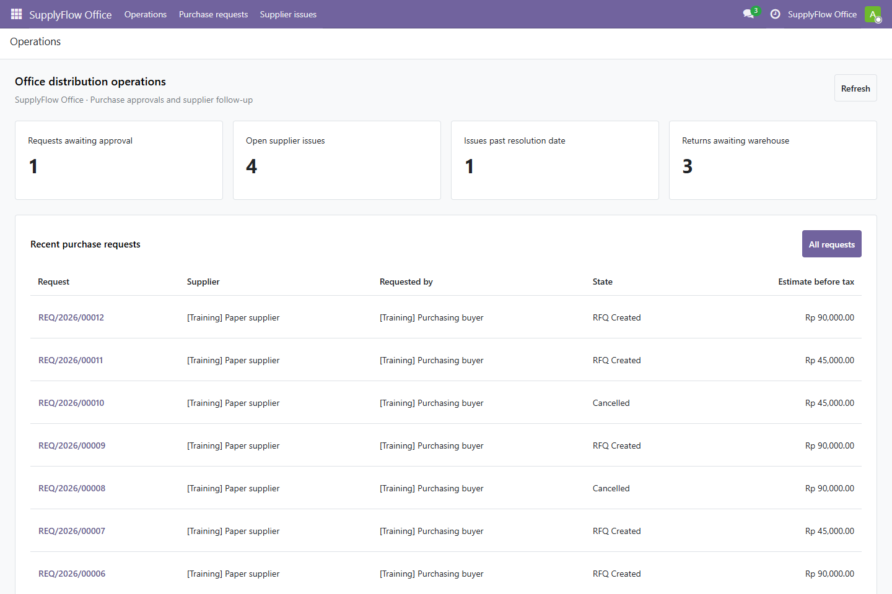
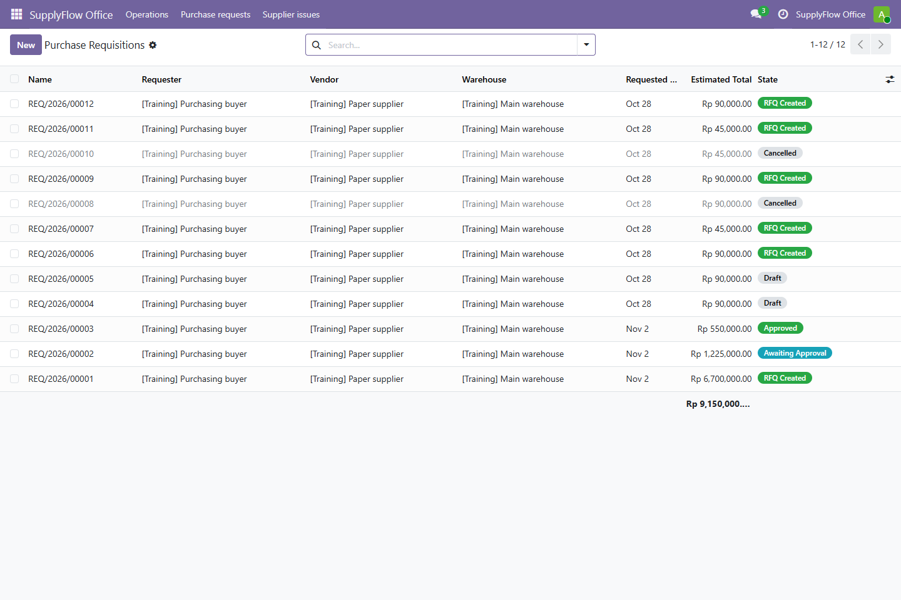
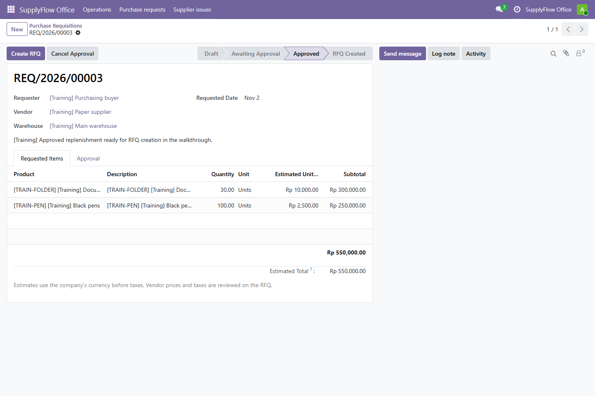
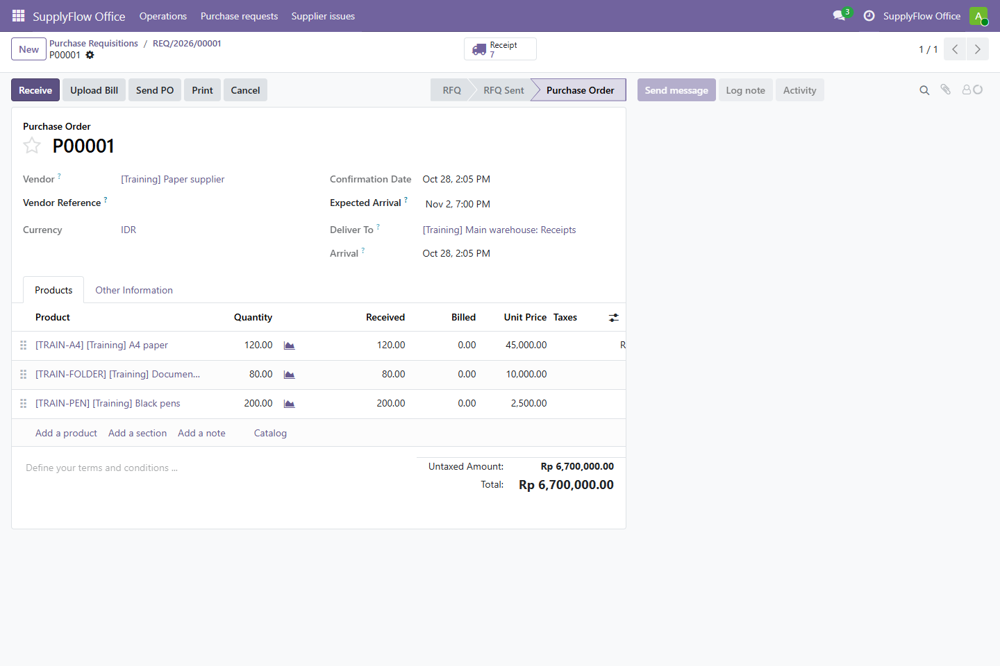
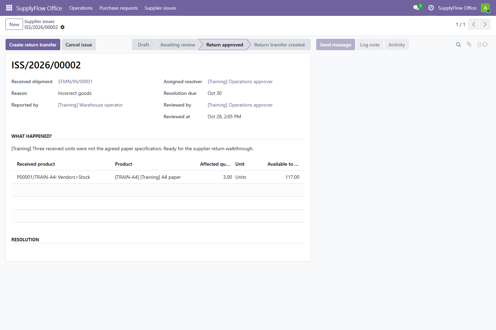
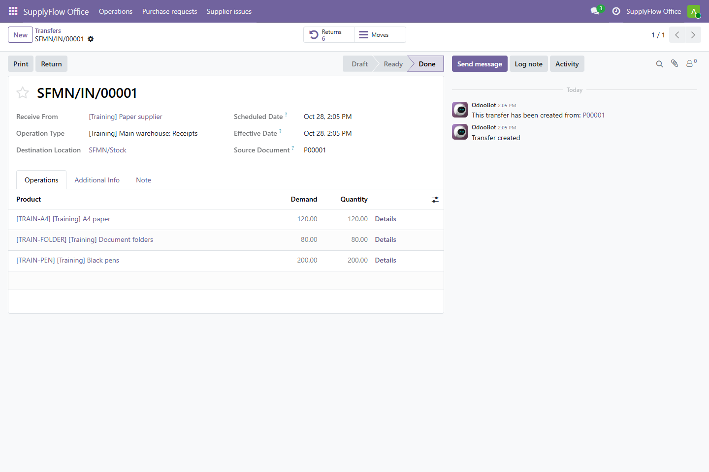
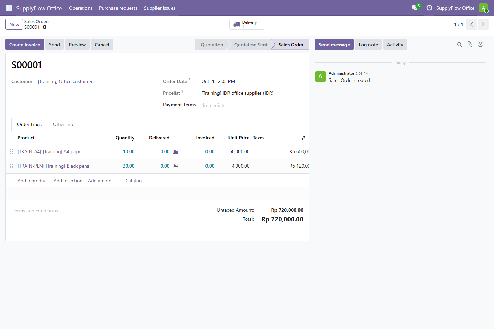
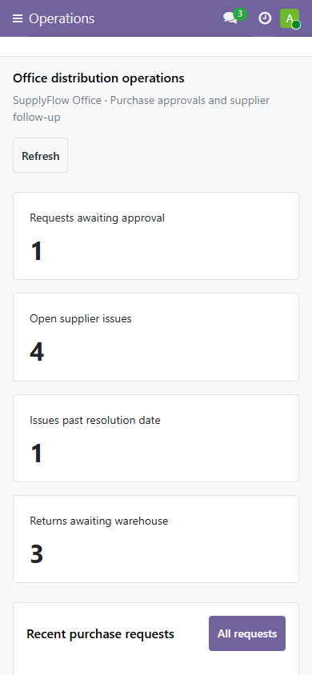

# SupplyFlow Office

ERP distributor perlengkapan kantor berbasis Odoo Community 19. Pembelian, penerimaan barang, stok gudang, penjualan, dan pengiriman memakai modul standar Odoo. Addon Python `supplyflow_office` menambahkan permintaan pembelian dengan persetujuan independen serta penanganan masalah barang masuk yang terhubung ke retur pemasok.

Proyek ini memakai Python, PostgreSQL 17, XML/QWeb, Owl JavaScript, dan Docker Compose. Tidak memerlukan modul Enterprise.

## Belajar membuat proyek ini

[Tutorial Odoo dari nol](docs/tutorial/README.md) menjelaskan urutan pembuatan, penempatan kode, fungsi setiap file, masukan/hasil fungsi, serta cara mengecek setiap tahap. Tersedia delapan bab, termasuk indeks 86 fungsi Python ERP/tool operasinya dan helper PowerShell, Owl, serta browser. [Buku PDF](docs/tutorial/supplyflow-office-tutorial.pdf) menyediakan materi yang sama untuk dibaca terpisah.

## Tampilan aplikasi

Gambar diambil dari Odoo yang dijalankan secara lokal. Nama berawalan `[Training]` adalah data latihan sintetis; hitungan workspace berasal dari dokumen latihan dan pemeriksaan, bukan aktivitas perusahaan nyata.



<details>
<summary>Lihat form, transaksi native, dan tampilan mobile</summary>

**Daftar permintaan pembelian**



**Permintaan disetujui, siap dibuatkan RFQ**



**Purchase order Odoo yang terhubung ke permintaan**



**Kasus barang masuk yang disetujui untuk retur**



**Receipt yang sudah divalidasi**



**Sales order native**



**Workspace pada layar 390 px**



</details>

## Jalankan di komputer sendiri

Pasang Docker Desktop dengan Linux containers dan jalankan perintah berikut dari PowerShell di folder proyek:

```powershell
.\scripts\Start.ps1 -WithTrainingData
```

Buka **http://localhost:8070**. Login awal dan kata sandi ada di file lokal `.secrets/LOCAL-CREDENTIALS.txt`. Kata sandi dibuat otomatis; tidak ada kata sandi bawaan yang harus dipakai semua pengguna.

`-WithTrainingData` memuat data sintetis bertanda `[Training]`, termasuk produk, pemasok, dua gudang latihan, pengguna dengan peran berbeda, pembelian yang sudah diterima, dan dokumen yang menunggu tinjauan. Gudang bawaan Odoo tetap tersedia. Gunakan `Start.ps1` tanpa opsi tersebut untuk instalasi baru yang kosong. Unduhan dan ekstraksi image pertama membutuhkan waktu serta ruang disk; menjalankan ulang tidak mengunduh seluruh image lagi.

```powershell
# Hentikan layanan proyek ini, data tetap tersimpan.
.\scripts\Stop.ps1

# Nyalakan kembali menggunakan image yang sudah tersedia.
.\scripts\Start.ps1 -SkipPull
```

Port dibatasi ke komputer lokal. PostgreSQL tidak membuka port ke host. Volume Docker menyimpan database dan filestore; menyimpan folder repo saja belum mencadangkan data tersebut.

## Apa yang dibuat dalam addon ini?

| Kebutuhan | Implementasi |
| --- | --- |
| Permintaan perlengkapan | Pengaju memilih pemasok, gudang, barang, jumlah dan estimasi sebelum pajak |
| Persetujuan | Pengguna lain dengan peran Approver menyetujui atau menolak; alasan wajib untuk penolakan |
| Membuat RFQ | Permintaan disetujui menghasilkan satu RFQ native; pengulangan membuka RFQ yang sama |
| Masalah barang masuk | Laporan mengacu ke receipt yang sudah selesai dan baris barang yang benar-benar diterima |
| Retur pemasok | Persetujuan menghasilkan transfer retur native; stok berubah ketika petugas gudang memvalidasi transfer |
| Barang kurang | Diselesaikan dengan catatan keputusan; barang yang belum diterima tidak dibuatkan retur fisik |
| Pemantauan | Workspace menampilkan jumlah pekerjaan berdasarkan data dan izin pengguna, dengan tautan ke daftar terkait |
| Dokumen | Ringkasan permintaan dapat dicetak sebagai PDF melalui laporan QWeb |

Harga, pajak, dan syarat pemasok tetap diperiksa pada RFQ sebelum konfirmasi. Estimasi permintaan bukan realisasi pengeluaran atau anggaran akuntansi.

## Alur yang bisa dicoba

1. Masuk sebagai `buyer`, buka **SupplyFlow Office → Purchase requests**, lalu buat dan ajukan permintaan.
2. Masuk sebagai `approver`, tinjau permintaan pengguna lain, kemudian pilih **Approve → Create RFQ**.
3. Buka aplikasi **Purchase**, periksa RFQ, konfirmasi pembelian, lalu proses receipt melalui **Inventory**.
4. Sebagai `warehouse`, laporkan masalah receipt melalui **Supplier issues**. Approver dapat menyetujui retur atau mencatat penyelesaian tanpa retur.
5. Transfer retur yang dibuat masih perlu diperiksa dan divalidasi di Inventory. Penjualan dan pengiriman pelanggan dilakukan melalui aplikasi standar **Sales** dan **Inventory**.

Ketiga akun peran hanya dibuat ketika data latihan dimuat. Gunakan kata sandi masing-masing dari file kredensial lokal. Akun `admin` mengatur konfigurasi dan hak akses.

Persetujuan SupplyFlow berlaku pada dokumen addon ini. Hak native Odoo tetap berlaku untuk membuat RFQ atau retur langsung di aplikasi standar. Memaksa seluruh transaksi melewati SupplyFlow memerlukan kebijakan dan pembatasan tambahan.

## Struktur kode

```text
addons/supplyflow_office/
  models/       model permintaan, masalah pemasok dan RPC workspace
  security/     grup akses, ACL dan aturan perusahaan
  views/        form, list, pencarian dan menu native
  reports/      laporan QWeb
  static/src/   workspace Owl
  tests/        pengujian ORM dan alur stok nyata
scripts/
  container/    inisialisasi, data latihan, backup dan restore
tests/browser/  pengujian browser dan pengambilan screenshot
docs/           PRD, diagram alur, arsitektur dan panduan kode
```

Mulai dari [panduan kode](docs/CODE-GUIDE.md) untuk memahami cara kerja proyek. [PRD](docs/PRD.md) menjelaskan kebutuhan, [diagram alur](docs/FLOWS.md) menunjukkan hubungan proses, dan [arsitektur](docs/ARCHITECTURE.md) memisahkan fitur standar Odoo dari addon buatan sendiri. Keputusan antarmuka ada di [catatan desain](docs/DESIGN.md).

[Catatan verifikasi](docs/VERIFICATION.md) menghubungkan kebutuhan dengan hasil tes, uji konkurensi, PDF, serta latihan backup/restore. Tes ORM menjalankan alur stok native, termasuk receipt sebagian, backorder, retur, transfer gudang, dan delivery pelanggan.

[Pemeriksaan antarmuka](docs/DELIVERY-GATE.md) mencatat bukti keyboard, kontras, keadaan workspace, dan reflow form pada layar kecil.

## Uji dan pengembangan

Hasil lokal: **42 tes ORM**, **25 tes validator arsip**, dan **9 skenario browser** lulus. Satu tes capture tambahan menghasilkan delapan screenshot. Latihan restore menggunakan volume baru dan membandingkan data serta berkas filestore; rincian bukti dan batas pemeriksaan ada di [catatan verifikasi](docs/VERIFICATION.md).

[GitHub Actions pada sumber terakhir](https://github.com/zalamanga/supplyflow-odoo/actions/runs/40655694868) juga lulus: instalasi baru, 42 tes ORM termasuk akses lintas perusahaan lewat ID, 25 tes arsip, pemuatan data latihan, dan sembilan workflow Chromium.

```powershell
# Membuat database uji tersendiri, menjalankan tes addon, lalu menghapus database uji.
# Layanan Odoo proyek ini dihentikan selama tes untuk mengurangi penggunaan memori.
.\scripts\Test.ps1

# Menyalakan aplikasi dan menyiapkan pengguna sintetis untuk uji browser.
.\scripts\Start.ps1 -WithTrainingData -SkipPull
npm ci
npm run test:browser

# Mengambil gambar dari layar aplikasi yang sedang berjalan.
npm run screenshots
```

Untuk menjalankan tes browser di Linux/CI, pasang browser Playwright dan set `PLAYWRIGHT_CHANNEL=chromium`; konfigurasi lokal Windows memakai Microsoft Edge. Tes arsip backup dapat dijalankan tanpa Odoo melalui `python -m unittest discover -s tests -p test_backup_archive.py`.

Compose memakai image resmi Odoo dengan folder addon dan script yang dipasang read-only. Jika model atau XML berubah, perbarui addon saat layanan Odoo berhenti:

```powershell
docker compose stop odoo
docker compose run --rm -T odoo python3 /opt/supplyflow/manage.py update
docker compose up -d --wait odoo
```

## Cadangan dan batas penggunaan

```powershell
.\scripts\Backup.ps1
# Restore mengganti isi database lokal. Pilih arsip milik sendiri yang sudah dipercaya.
.\scripts\Restore.ps1 -Archive "D:\cadangan\supplyflow-....zip" -ReplaceDatabase
```

Baca [panduan operasi](docs/OPERATIONS.md) sebelum memulihkan data. Cadangan berisi database, hash kata sandi pengguna, dan filestore. Simpan privat. File `.secrets`, `.runtime`, cadangan, serta hasil pengujian tidak dimasukkan ke Git.

Konfigurasi ini ditujukan untuk penggunaan lokal dan pembelajaran pengembangan ERP. Deployment publik memerlukan HTTPS, pengaturan proxy, SMTP, pencadangan terjadwal, pemantauan, serta evaluasi hak akses dan konfigurasi bisnis. Proyek tidak mengklaim telah mengimplementasikan akuntansi, perpajakan, pembayaran, atau integrasi pemasok.

## Referensi dan lisensi

Basis yang dipakai adalah **Odoo Community 19**, dipilih secara sengaja dan bukan klaim sebagai versi terbaru. Image ditetapkan ke `19.0-20261015`. Dokumentasi resmi: [pengembangan Odoo](https://www.odoo.com/documentation/19.0/developer.html), [keamanan addon](https://www.odoo.com/documentation/19.0/developer/reference/backend/security.html), [pengujian](https://www.odoo.com/documentation/19.0/developer/reference/backend/testing.html), dan [lisensi Odoo](https://www.odoo.com/documentation/19.0/legal/licenses.html).

Addon dan script proyek menggunakan [LGPL-3.0](LICENSE). Odoo serta dependensinya tetap mengikuti lisensi upstream masing-masing.
