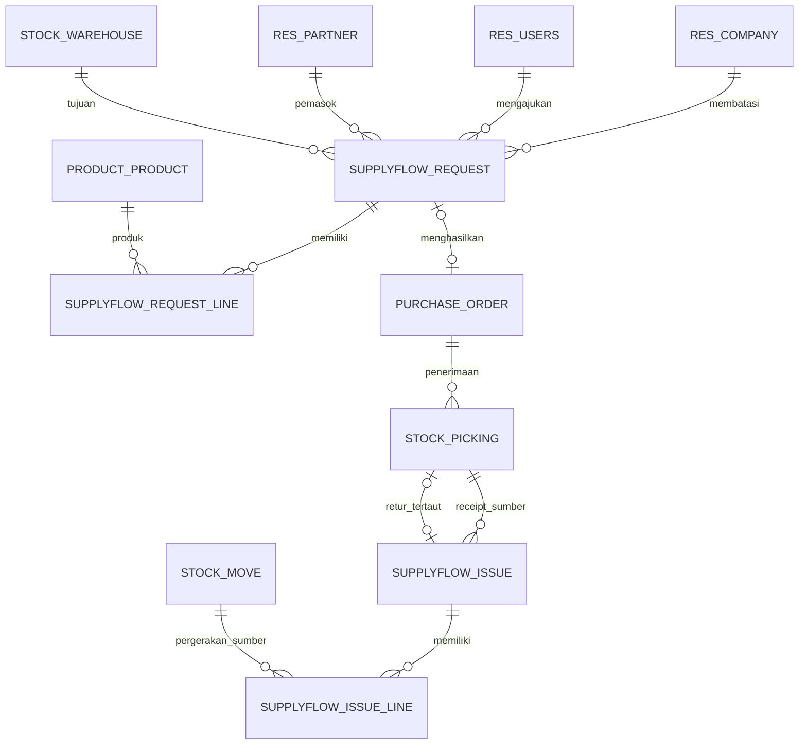

# Arsitektur SupplyFlow Office

SupplyFlow Office memperluas Odoo Community melalui satu addon, `supplyflow_office`. Odoo tetap menjadi server aplikasi, autentikasi, ORM, antarmuka web, dan mesin transaksi stok. Tidak ada backend kedua atau frontend React yang menduplikasi model Odoo.

Dokumen ini menjelaskan rancangan awal. Perintah dan hasil verifikasi harus dicocokkan dengan implementasi sebelum petunjuk operasional akhir diterbitkan.

## Komponen dan keputusan versi

| Komponen | Pilihan | Alasan |
| --- | --- | --- |
| ERP | Odoo Community 19, image `19.0-20261015` | Versi stabil yang dipatok untuk pengembangan dan pengujian addon ini |
| Database | PostgreSQL 17 | Database relasional untuk data Odoo; dipisahkan dari proses aplikasi |
| Addon | Python, XML, CSV security, QWeb sesuai kebutuhan | Memakai model, views, aksi, ACL, dan laporan Odoo secara langsung |
| Antarmuka | Web client native Odoo | Pengguna dapat berpindah antara permintaan, RFQ, receipt, dan retur dengan pola yang sama |
| Runtime lokal | Docker Compose | Menjalankan versi aplikasi dan database yang sesuai tanpa memasang seluruh dependency di Windows |
| Host aplikasi | `127.0.0.1:8070` | Akses pengembangan lokal; tidak membuka ERP ke jaringan publik |

Odoo 20 tersedia, tetapi proyek ini sengaja menargetkan seri 19. Mematok tag bertanggal mengurangi perubahan tak terduga pada runtime. Tag bertanggal tetap berbeda dari pin digest; digest image yang benar-benar diuji perlu dicatat bila diperlukan reproduksi bit-for-bit.

Community dan Enterprise mempunyai lisensi serta cakupan yang berbeda. Implementasi ini memakai Community dan addon standar `purchase_stock`, `sale_stock`, serta `mail`; tidak mengambil kode atau aset Enterprise. Lisensi addon dan lisensi upstream harus dibaca pada berkas masing-masing.

## Kepemilikan perilaku

| Bagian | Tanggung jawab |
| --- | --- |
| Odoo standar | Pengguna, kelompok, perusahaan, kontak, produk, UoM, quotation, SO, RFQ, PO, picking, stock move, quant, backorder, retur, chatter |
| `supplyflow.request` | Permintaan kebutuhan internal, pembekuan saat diajukan, keputusan independen, hubungan tunggal ke RFQ |
| `supplyflow.request.line` | Produk, satuan dasar, jumlah, dan estimasi biaya permintaan |
| `supplyflow.issue` | Kasus receipt selesai, keputusan penanganan, catatan penyelesaian, hubungan tunggal ke retur |
| `supplyflow.issue.line` | Hubungan barang/pergerakan sumber dengan kuantitas masalah yang ditinjau |
| Views addon | Form, daftar, filter, status, tindakan, dan navigasi ke dokumen native |
| Workspace Owl | Ringkasan pekerjaan dari ORM, permintaan terbaru, dan tindakan menuju daftar dokumen yang mendasarinya |
| Setup dan data latihan | Inisialisasi lokal, pemasangan addon, serta fixture sintetis yang hanya dimuat bila dipilih |

Pembuatan RFQ menggunakan ORM Purchase. Pembuatan retur menggunakan mekanisme retur Inventory. Addon tidak menulis `stock.quant` untuk memindahkan barang dan tidak mengganti validasi picking. Dengan pemisahan ini, receipt dan retur tetap dapat ditelusuri melalui dokumen standar Odoo.

## Hubungan data

Diagram menyoroti hubungan addon. Diagram ini tidak menggantikan ERD lengkap Odoo; satu PO dapat berhubungan dengan beberapa penerimaan/backorder dan proses native mempunyai relasi tambahan.

## Lapisan pengamanan

### ACL dan record rule

ACL membatasi operasi model berdasarkan kelompok. Record rule membatasi data yang terlihat dan dapat diubah, termasuk perusahaan yang diizinkan pada sesi. Pengaju biasa bekerja dengan dokumennya sendiri; penyetuju meninjau dokumen yang sesuai perusahaan dan izinnya.

XML ID kelompok addon adalah `supplyflow_office.group_user` dan `supplyflow_office.group_approver`. Workspace menghitung data melalui izin pengguna dan perusahaan aktif, bukan memakai `sudo()` untuk menyajikan semua dokumen perusahaan.

Izin addon tidak menggantikan izin Purchase atau Inventory. Aksi yang membuat objek native harus memeriksa izin native pengguna. Relasi ke dokumen tidak memberi izin membaca dokumen tersebut secara otomatis.

### Metode bisnis di server

Tombol form membantu pengguna menemukan aksi, tetapi pemanggil RPC dapat mencoba metode tanpa mengklik tombol. Metode server harus memeriksa status, ACL/record rule, kelompok, perusahaan, dan pelaksana sebelum mengubah data.

Status, metadata keputusan, pembuat/pengaju, dan tautan RFQ/retur merupakan field terkendali. Penulisan biasa tidak boleh melewati metode transisi. Membekukan parent saja tidak cukup; tambah, ubah, dan hapus baris juga perlu dicegah setelah pengajuan.

Penyetuju harus berbeda dari pengaju dan pembuat dokumen. Larangan tersebut tetap diperiksa saat pengguna memiliki kelompok pengaju sekaligus penyetuju. Mekanisme aplikasi tidak membatasi pemilik database atau superuser yang sengaja menggunakan hak administratif penuh.

### Transaksi dan pengulangan aksi

RFQ dan retur tertaut dibuat dalam transaksi yang sama dengan perubahan dokumen addon. Aksi mengunci baris sumber sebelum memeriksa relasi hasil. Pemeriksaan tautan setelah lock mencegah dua transaksi membuat dokumen hasil pada waktu yang sama.

Pemanggilan ulang atas dokumen yang sudah mempunyai hasil harus membuka hasil yang sama. Ini berbeda dari sekadar menonaktifkan tombol setelah klik. Kegagalan pembuatan dokumen native harus menggagalkan transaksi, sehingga status tidak tertinggal seolah proses berhasil.

### Batas jumlah retur

Jumlah kasus tidak boleh mengabaikan jumlah yang benar-benar diterima atau retur yang sudah terjadi. Pemeriksaan memakai pergerakan sumber, satuan dan pembulatan produk, serta sisa yang dapat diretur. Barang shortage tidak dibuatkan retur fisik. Kasus hanya menyiapkan picking; petugas gudang memvalidasinya dengan aturan Inventory.

## Tiga jenis kredensial

| Kredensial | Dipakai untuk | Bukan untuk |
| --- | --- | --- |
| Password master Odoo | Operasi pengelolaan database Odoo bila endpoint tersebut diaktifkan | Login pengguna bisnis |
| Password role PostgreSQL | Koneksi proses Odoo ke database | Login lewat halaman Odoo |
| Password pengguna Odoo | Login dan aksi sesuai kelompok pengguna | Akses langsung PostgreSQL atau pengelolaan database |

Setup harus membuat secret lokal dan mengabaikannya dari Git. Kredensial login hasil setup disimpan pada `.secrets/LOCAL-CREDENTIALS.txt`. Repo hanya memuat template atau nama variabel. Password tidak boleh menjadi data latihan yang dipublikasikan bersama screenshot, output console, atau URL.

Database target dibatasi ke database aplikasi dan `list_db` dimatikan. Role aplikasi PostgreSQL tidak mempunyai hak superuser atau membuat database; akun administratif PostgreSQL memakai secret terpisah untuk bootstrap/pemeliharaan. Port PostgreSQL tidak dipublikasikan ke host. Penyaringan database dan penonaktifan daftar/pengelola database pada runtime biasa harus diverifikasi dari konfigurasi yang dipakai, bukan hanya dari contoh konfigurasi.

## Script lokal

| Script | Kontrak |
| --- | --- |
| `scripts/Start.ps1` | Build image, bootstrap database/addon bila diperlukan, lalu nyalakan stack |
| `scripts/Start.ps1 -WithTrainingData` | Menjalankan setup dengan data latihan sintetis yang dipilih secara eksplisit |
| `scripts/Load-TrainingData.ps1` | Memuat data latihan ke instalasi lokal yang sudah disiapkan |
| `scripts/Stop.ps1` | Menghentikan stack milik SupplyFlow tanpa menghapus data |
| `scripts/Test.ps1` | Menjalankan pemeriksaan addon pada database pengujian terpisah |
| `scripts/Backup.ps1` | Mengambil dump database dan filestore yang konsisten |
| `scripts/Restore.ps1` | Memvalidasi arsip dan memulihkan data melalui proses yang terdokumentasi |

Tabel ini menetapkan tujuan script. README dan catatan verifikasi akhir harus memakai opsi yang benar-benar tersedia dan mencatat pengujian script tersebut.

## Penyimpanan dan cadangan

PostgreSQL menyimpan tabel aplikasi dan metadata lampiran. Direktori data Odoo menyimpan filestore serta berkas runtime. Kode addon berada di repo dan dapat dipulihkan dari Git, tetapi kode tidak menggantikan cadangan data.

Cadangan yang dapat dipulihkan harus mencakup dump PostgreSQL dan filestore dari keadaan yang konsisten. Cara lokal paling mudah adalah menghentikan penulisan aplikasi selama pengambilan cadangan. Password dan konfigurasi lokal perlu disimpan terpisah dengan akses terbatas; jangan menambahkannya ke repo untuk memudahkan restore.

Restore harus dilakukan ke database dan volume terpisah terlebih dahulu. Pemeriksaan minimal mencakup jumlah/relasi dokumen, pengguna dan perusahaan, serta satu lampiran yang dapat dibuka. Keberhasilan perintah backup tanpa uji pemulihan belum membuktikan cadangan dapat dipakai.

## Pengujian yang diperlukan

Tes model Odoo membuktikan aturan transisi, validasi, ACL, record rule, field terkendali, dan integrasi dokumen native. Tes transaksi terpisah diperlukan untuk klaim pencegahan duplikasi bersamaan. Tes browser memeriksa alur yang benar-benar dapat digunakan melalui web client.

Pemeriksaan instalasi memakai database kosong. Pemeriksaan restart dan restore memakai volume yang jelas terpisah dari stack proyek lain. Data latihan hanya memakai informasi sintetis yang diberi label; proyek tidak memerlukan salinan database kerja pengguna.

Hasil pengujian perlu menyebut versi image, tanggal pelaksanaan, perintah, jumlah tes jika tersedia, serta skenario yang belum diperiksa. Screenshot berasal dari aplikasi yang berjalan dan harus sesuai dengan implementasi yang dipublikasikan.

## Batas operasional

Compose dirancang untuk pengembangan lokal pada satu komputer. Binding localhost, secret yang tidak masuk Git, dan aturan aplikasi tidak otomatis menjadikan konfigurasi ini siap produksi. Publikasi server memerlukan keputusan tambahan mengenai TLS, reverse proxy, batas request, pemantauan, akses administratif, backup terjadwal, pembaruan, dan sizing.

Odoo dan PostgreSQL membutuhkan memori selain kapasitas disk. Pada komputer dengan memori terbatas, proses tes berat sebaiknya berjalan bergantian dengan server interaktif. Volume Docker berada di lokasi penyimpanan yang diatur Docker Desktop; lokasi repo di D: saja tidak memindahkan seluruh volume secara otomatis.

## Rujukan upstream

- [Dokumentasi pengembang Odoo 19](https://www.odoo.com/documentation/19.0/developer.html)
- [Keamanan model Odoo](https://www.odoo.com/documentation/19.0/developer/reference/backend/security.html)
- [Deployment Odoo on-premise](https://www.odoo.com/documentation/19.0/administration/on_premise/deploy.html)
- [Lisensi Odoo 19](https://www.odoo.com/documentation/19.0/legal/licenses.html)
- [Manifest image resmi Odoo](https://github.com/docker-library/official-images/blob/master/library/odoo)
- [Dockerfile Odoo 19](https://github.com/odoo/docker/blob/master/19.0/Dockerfile)
- [Entrypoint image Odoo 19](https://github.com/odoo/docker/blob/master/19.0/entrypoint.sh)
- [Kode Purchase dan Inventory Odoo 19](https://github.com/odoo/odoo/tree/19.0/addons/purchase_stock)

Tautan upstream dapat bergerak mengikuti pemeliharaan seri 19. Versi runtime yang dipatok dan hasil pengujian proyek tetap menjadi acuan perilaku build ini.
