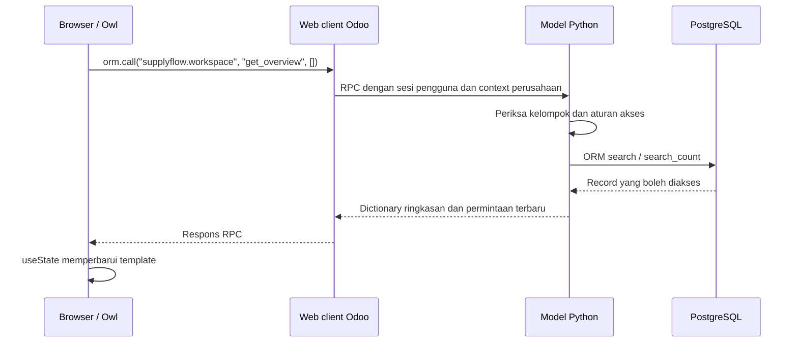

# Memahami kode SupplyFlow Office

SupplyFlow Office memakai Odoo Community sebagai ERP dan menambahkan addon `supplyflow_office`. Odoo menyediakan login, pengguna, perusahaan, ORM, web client, Sales, Purchase, Inventory, dan mesin stok. Kode proyek menambahkan permintaan pembelian internal, persetujuan independen, penanganan masalah penerimaan, ringkasan pekerjaan, serta alat instalasi/pengujian lokal.

Untuk mengikuti urutan pembuatannya, mulai dari [tutorial delapan bab](tutorial/README.md). Panduan ini tetap menjadi ringkasan arsitektur kode; tutorial memberi langkah penulisan, cuplikan per fungsi, checkpoint, dan latihan dari kerangka addon sampai versi lengkap.

Penjelasan yang tepat saat interview: “Saya memperluas Odoo Community untuk distributor perlengkapan kantor. Saya menghubungkan permintaan yang disetujui ke RFQ native, lalu kasus receipt ke retur pemasok, dengan aturan akses dan transisi di server.” Ini menjelaskan pekerjaan custom tanpa mengklaim membangun seluruh ERP dari nol.

## Mulai menjalankan dan membaca kode

```powershell
cd "D:\kerjaan\done push repo\supplyflow-odoo"
Remove-Item Env:COMPOSE_PROJECT_NAME -ErrorAction SilentlyContinue
.\scripts\Start.ps1 -WithTrainingData
```

Buka `http://localhost:8070`. Login hasil setup ada pada `.secrets/LOCAL-CREDENTIALS.txt`. Password dibuat lokal; jangan mencari password default pada README atau menyalin berkas secret ke GitHub. Data latihan bersifat opt-in dan memakai penanda `[Training]`.

Urutan baca yang membantu: manifest, model permintaan, security, views, model kasus receipt, workspace, lalu script Docker. [PRD](PRD.md) menjelaskan kebutuhan, [FLOWS](FLOWS.md) menunjukkan proses, dan [OPERATIONS](OPERATIONS.md) memuat backup/restore.

## Peta berkas addon

Semua path pada tabel dapat dibuka langsung dari repo.

| Berkas | Fungsi |
| --- | --- |
| [__manifest__.py](../addons/supplyflow_office/__manifest__.py) | Nama/versi/lisensi addon, dependency `purchase_stock`, `sale_stock`, `mail`, urutan pemuatan XML/CSV, serta asset backend |
| [__init__.py](../addons/supplyflow_office/__init__.py), [models/__init__.py](../addons/supplyflow_office/models/__init__.py) | Mengimpor model Python agar terdaftar saat addon dimuat |
| [purchase_request.py](../addons/supplyflow_office/models/purchase_request.py) | Model permintaan/baris, estimasi, pembekuan, keputusan, dan pembuatan RFQ |
| [supplier_issue.py](../addons/supplyflow_office/models/supplier_issue.py) | Model kasus/baris, validasi receipt, sisa jumlah retur, keputusan, wizard retur, dan revisi sumber pada `stock.move` |
| [workspace.py](../addons/supplyflow_office/models/workspace.py) | Abstract model yang mengembalikan ringkasan pekerjaan dan permintaan terbaru dari data yang boleh dibaca pengguna |
| [groups.xml](../addons/supplyflow_office/security/groups.xml) | Kelompok Requester/Approver; Approver juga memperoleh kelompok Requester |
| [ir.model.access.csv](../addons/supplyflow_office/security/ir.model.access.csv) | Hak operasi model untuk anggota addon; belum menentukan dokumen/status mana yang boleh diubah |
| [company_rules.xml](../addons/supplyflow_office/security/company_rules.xml) | Record rule untuk perusahaan aktif yang diizinkan pada parent dan baris |
| [sequences.xml](../addons/supplyflow_office/data/sequences.xml) | Penomoran permintaan dan kasus |
| [purchase_request_views.xml](../addons/supplyflow_office/views/purchase_request_views.xml) | Form, daftar, pencarian, tombol workflow, dan action permintaan |
| [supplier_issue_views.xml](../addons/supplyflow_office/views/supplier_issue_views.xml) | Form, daftar, pencarian, tindakan receipt/retur, dan filter kasus |
| [menus.xml](../addons/supplyflow_office/views/menus.xml) | Menu aplikasi dan client action workspace |
| [purchase_request_report.xml](../addons/supplyflow_office/reports/purchase_request_report.xml) | QWeb PDF ringkasan permintaan; estimasi dibedakan dari pesanan pemasok |
| [workspace.js](../addons/supplyflow_office/static/src/workspace.js) | Komponen Owl, pemuatan RPC, loading/error, refresh, dan pembukaan action native |
| [workspace.xml](../addons/supplyflow_office/static/src/workspace.xml) | Template Owl untuk ringkasan, daftar terbaru, dan tindakan |
| [workspace.scss](../addons/supplyflow_office/static/src/workspace.scss) | Tata letak workspace di dalam web client Odoo |

## Model, field, dan ORM

`_name = "supplyflow.request"` mendaftarkan model baru. `models.Model` memakai ORM Odoo untuk membaca/menulis PostgreSQL. `_inherit = ["mail.thread", "mail.activity.mixin"]` menambahkan chatter serta dukungan aktivitas; `tracking=True` menandai perubahan field untuk riwayat.

`Many2one` menyimpan hubungan ke satu record, misalnya pemasok. `One2many` menghubungkan permintaan dengan barisnya melalui `request_id`. `related` mengambil nilai dari hubungan, seperti mata uang perusahaan. `compute` menghitung nilai; `store=True` menyimpan hasilnya agar dapat dicari atau digunakan kembali.

Contoh bentuk pembuatan permintaan melalui ORM di dalam environment Odoo:

```python
from odoo import Command

request = env["supplyflow.request"].create({
    "vendor_id": vendor.id,
    "warehouse_id": warehouse.id,
    "purpose": "Menambah persediaan kertas kantor",
    "line_ids": [Command.create({
        "product_id": product.id,
        "product_qty": 2,
        "price_estimated": 45000,
    })],
})
```

`vendor`, `warehouse`, dan `product` pada contoh harus merupakan record yang benar-benar ada serta boleh diakses. `Command.create` membuat baris bersama parent; padanan pada RPC adalah command relasi `[0, 0, {...}]`. Contoh ini dijalankan pada shell/test Odoo, bukan interpreter Python kosong.

`@api.depends` mendeklarasikan dependency perhitungan subtotal/total. `@api.onchange` membantu form, misalnya memilih gudang setelah perusahaan dipilih; validasi keamanan tidak bergantung pada onchange. `@api.constrains` memeriksa data di server. `models.Constraint` menambahkan pembatas database seperti jumlah positif dan RFQ tertaut yang unik.

`@api.model_create_multi` mendukung pembuatan beberapa record sekaligus. Override `create`, `write`, dan `unlink` menolak perubahan field terlindungi, manipulasi identitas pengaju, atau perubahan baris setelah pengajuan. Pemeriksaan jumlah juga memperhatikan angka non-finite dan ketelitian satuan produk.

## Permintaan: dari draft menjadi RFQ

Statusnya `draft → submitted → approved → rfq_created`. Pengajuan dapat ditolak dengan alasan menjadi `rejected`; pengaju dapat mereset penolakan ke draft untuk peninjauan baru. Pembatalan tersedia pada status yang diizinkan, sedangkan RFQ yang sudah dibuat dikelola dari Purchase.

`action_submit()` memeriksa pemilik, status, isi, dan baris sebelum membekukan permintaan. `action_approve()`/`action_reject()` memerlukan Approver yang berbeda dari pengaju maupun pembuat. Aksi menetapkan metadata pelaksana/waktu dan menulis pesan chatter. Field readonly pada XML membantu pengguna, tetapi pemeriksaan Python tetap berlaku pada RPC.

`_lock_for_change()` memeriksa akses, mengunci baris, menghapus cache record, lalu memeriksa akses kembali. `_transition()` adalah jalur internal perubahan status setelah pemeriksaan; bukan flag context yang dapat dikirim browser untuk membuka field audit.

`action_create_rfq()` mengembalikan RFQ yang sama jika tautan sudah ada. Untuk hasil baru, metode membuat `purchase.order` melalui ORM dengan pemasok, mata uang perusahaan, gudang incoming, origin nomor permintaan, dan baris produk. Hak native Purchase tetap berlaku karena pembuatan tidak memakai `sudo()` menyeluruh.

Perhitungan pemasok Odoo dapat mengganti harga/deskripsi awal. Kode mengembalikan estimasi permintaan, termasuk harga nol yang disengaja, lalu meminta petugas meninjau harga dan pajak di Purchase. RFQ masih draft: pembuatan RFQ belum mengonfirmasi PO atau mengubah stok.

## Kasus receipt dan retur

`supplyflow.issue` hanya menerima receipt incoming yang sudah `done`. Baris kasus menunjuk `stock.move` dari receipt tersebut. Statusnya `draft → submitted → approved → return_created` untuk retur, atau `submitted → accepted` untuk penyelesaian tanpa retur dengan catatan. Kasus memiliki pembatalan, tetapi tidak mempunyai status rejected/reset seperti permintaan pembelian.

`action_approve()` memeriksa penyetuju independen dan kelayakan retur. `shortage` tidak boleh menjadi retur barang fisik; gunakan `action_accept_resolution()` dengan catatan. Menyetujui kasus dan memvalidasi picking adalah dua tindakan berbeda.

`action_create_return()` mengunci kasus serta stock move sumber, memeriksa sisa jumlah, lalu menggunakan wizard native `stock.return.picking`. Baris wizard yang tidak terkait kasus diatur nol; jumlah yang terpilih mengikuti kasus. `action_create_returns()` menghasilkan picking native dan kasus menyimpan tautannya.

Jumlah yang masih dapat diretur memperhitungkan retur selesai serta retur belum dibatalkan yang masih menunggu. Perhitungan terbatas ini memakai `sudo()` untuk menghitung seluruh retur dari sumber/perusahaan yang sudah diotorisasi, termasuk sibling transfer yang tersembunyi oleh aturan tambahan; metode tidak mengembalikan daftar dokumen tersembunyi ke workspace.

Field tambahan `supplyflow_return_revision` pada `stock.move` dipakai jalur internal untuk mendeteksi transaksi sumber yang basi saat beberapa kasus mencoba membuat retur. Pengguna biasa tidak boleh menulis revisi langsung. Mekanisme ini melengkapi lock dan batas kuantitas addon; bukan pengganti seluruh aturan Inventory.

Stok baru berpindah ketika petugas gudang memvalidasi picking retur di Odoo. Addon tidak menulis kuantitas langsung pada `stock.quant` untuk menyelesaikan kasus.

## ACL, record rule, dan pemeriksaan aksi

ACL menjawab apakah kelompok boleh menjalankan operasi pada model. Record rule membatasi record berdasarkan perusahaan aktif. Pemeriksaan metode menjawab apakah orang tersebut boleh melakukan aksi pada status saat ini. Ketiganya diperlukan bersama.

Anggota SupplyFlow dapat membaca dokumen dalam perusahaan yang diizinkan untuk koordinasi. Mengedit draft dibatasi kepada pemiliknya melalui metode server. Approver tidak otomatis memperoleh seluruh izin Purchase/Inventory; kelompok native diberikan terpisah. Multi-perusahaan tidak berarti semua akun dapat membaca semua perusahaan.

`check_access()` memeriksa ACL/record rule. `has_group()` memeriksa kelompok. Pemeriksaan pemilik dan status membatasi aksi. Menyembunyikan tombol hanya lapisan UI. Pengguna yang tahu ID record atau endpoint RPC tetap menghadapi pemeriksaan server.

Chatter mencatat keputusan dan perubahan yang relevan. Riwayat itu membantu penelusuran operasional, tetapi tidak dinyatakan sebagai audit log yang kebal perubahan oleh pemilik database.

## Alur browser, Owl, Python, dan PostgreSQL



Proyek memakai RPC web client Odoo, bukan backend REST terpisah. Test browser memanggil jalur native `/web/dataset/call_kw/...` dengan sesi login Odoo. Mengganti UI tidak mengganti model autentikasi/otorisasi server.

Pada `workspace.js`, `useService("orm")` menyediakan panggilan model, sedangkan `useService("action")` membuka daftar/form Odoo. `onWillStart()` memuat data sebelum komponen siap. `useState` menyimpan loading, error, dan data. `try/catch/finally` memastikan kegagalan menampilkan pesan dan mengakhiri loading; tombol refresh memanggil pemuatan lagi.

`get_overview()` tidak memakai bypass akses menyeluruh. Ringkasannya menghitung permintaan submitted, kasus submitted/approved, kasus terbuka yang melewati tenggat, dan retur tertaut yang belum done/cancel. Delapan permintaan terbaru berasal dari pencarian ORM yang sama. Klik metrik membuka action dengan filter pencarian yang sesuai.

## Docker, konfigurasi, dan script

| Berkas | Fungsi |
| --- | --- |
| [compose.yaml](../compose.yaml) | Image resmi Odoo bertag tanggal/digest, PostgreSQL 17, healthcheck, volume, secret, bind mount kode read-only, dan binding `127.0.0.1:8070` |
| [Common.ps1](../scripts/Common.ps1) | Helper Compose, password acak, config lokal, dan berkas kredensial yang diabaikan Git |
| [Start.ps1](../scripts/Start.ps1), [Stop.ps1](../scripts/Stop.ps1) | Menyiapkan/menjalankan stack atau menghentikannya tanpa menghapus volume |
| [init-database.sh](../scripts/container/init-database.sh) | Membuat role aplikasi `supplyflow` tanpa superuser/createdb dan memberi kepemilikan database lokal |
| [manage.py](../scripts/container/manage.py) | Memeriksa instalasi addon, menjalankan inisialisasi/update, dan memilih pemuatan data latihan |
| [configure_instance.py](../scripts/container/configure_instance.py) | Konfigurasi pertama dan password admin dari secret; instance yang sudah diinisialisasi dipertahankan |
| [training_data.py](../scripts/container/training_data.py) | Fixture sintetis opt-in dengan identitas stabil agar pemanggilan ulang mempertahankan data/akun yang sudah dibuat |
| [Backup.ps1](../scripts/Backup.ps1), [backup.py](../scripts/container/backup.py) | Mengambil database dan filestore saat penulisan aplikasi dihentikan |
| [Restore.ps1](../scripts/Restore.ps1), [restore.py](../scripts/container/restore.py) | Memvalidasi dan memulihkan arsip terpercaya ke database tetap `supplyflow` |

Proyek menjalankan image resmi Odoo secara langsung, dengan user aplikasi `odoo`; tidak ada Dockerfile atau build image custom. `Start.ps1`/`Test.ps1` menarik image kecuali opsi `-SkipPull` dipilih. Addon terpasang read-only pada `/mnt/extra-addons`, sedangkan script container terpasang read-only pada `/opt/supplyflow`. Perubahan model/XML memerlukan update addon saat layanan Odoo dihentikan, seperti dijelaskan pada [panduan operasi](OPERATIONS.md).

Password master Odoo, password role PostgreSQL, dan password login pengguna adalah kredensial berbeda. Database tidak dipublikasikan ke port host. Konfigurasi menargetkan database tetap, mematikan daftar database, dan menyimpan secret di luar Git. Setup lokal ini tidak dinyatakan sebagai deployment publik produksi.

## Pengujian dan bahan penjelasan interview

| Lokasi | Yang diperiksa |
| --- | --- |
| [test_purchase_request.py](../addons/supplyflow_office/tests/test_purchase_request.py) | Transisi, validasi, pembekuan, izin, dan RFQ permintaan |
| [test_supplier_issue.py](../addons/supplyflow_office/tests/test_supplier_issue.py) | Sumber receipt, keputusan, batas jumlah, izin, dan retur |
| [test_distribution_flow.py](../addons/supplyflow_office/tests/test_distribution_flow.py) | Integrasi PO/receipt sebagian/backorder/retur dan penjualan/delivery native |
| [test_workspace.py](../addons/supplyflow_office/tests/test_workspace.py) | Angka dari dokumen nyata dan penolakan akun yang tidak memiliki kelompok |
| [test_backup_archive.py](../tests/test_backup_archive.py) | Format/hash/path/symlink/versi arsip tanpa menjalankan restore database |
| [workflows.spec.js](../tests/browser/workflows.spec.js) | Interaksi browser dan penolakan aksi lewat RPC di luar tombol UI |
| [screenshots.spec.js](../tests/browser/screenshots.spec.js) | Pengambilan layar dari aplikasi berjalan, terpisah dari tes alur utama |
| [verify.yml](../.github/workflows/verify.yml) | Rangkaian pemeriksaan otomatis GitHub Actions |

Tes ORM menggunakan fasilitas Odoo `TransactionCase` dan database pengujian. [Test.ps1](../scripts/Test.ps1) menyiapkan database bernama unik, menjalankan tes addon, lalu membersihkan database itu kecuali dipilih untuk disimpan. Tes browser memerlukan server dan data latihan; Node/Playwright di repo berfungsi untuk verifikasi, bukan sebagai server ERP.

```powershell
python -m unittest discover -s tests -p test_backup_archive.py
.\scripts\Test.ps1
.\scripts\Start.ps1 -WithTrainingData -SkipPull
npm ci
npm run test:browser
```

Perintah tes bukan bukti bahwa semua skenario sudah lulus. Gunakan catatan verifikasi akhir untuk hasil aktual, versi, dan keterbatasan pemeriksaan. Tes arsip tidak menggantikan latihan restore PostgreSQL beserta lampiran.

Saat menjelaskan hasil, tunjukkan satu permintaan dari akun pengaju, persetujuan akun lain, dan RFQ tertaut. Lanjutkan dengan receipt bermasalah sampai picking retur dibuat, lalu tunjukkan bahwa stok belum berubah sebelum validasi gudang. Tutup dengan lokasi pemeriksaan izin di Python, bukan hanya tombol yang disembunyikan pada XML.
