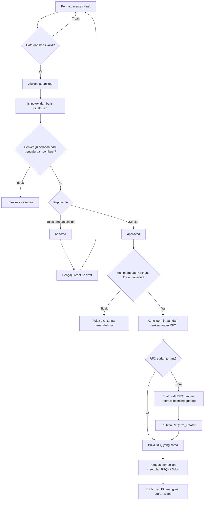
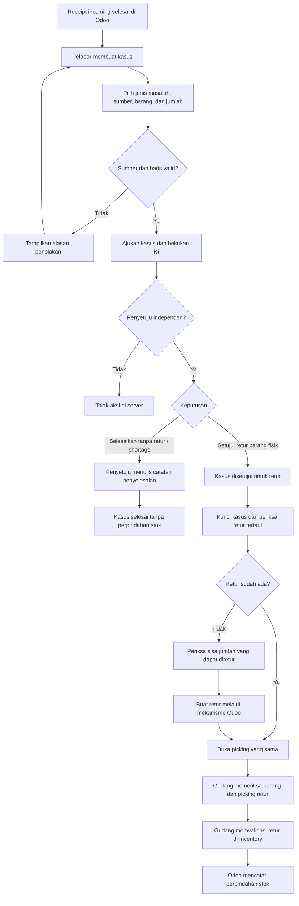
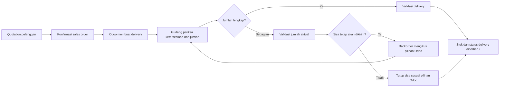
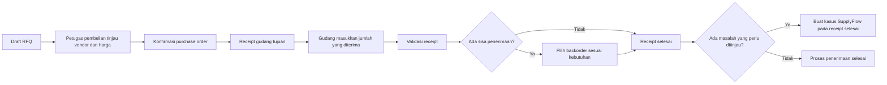
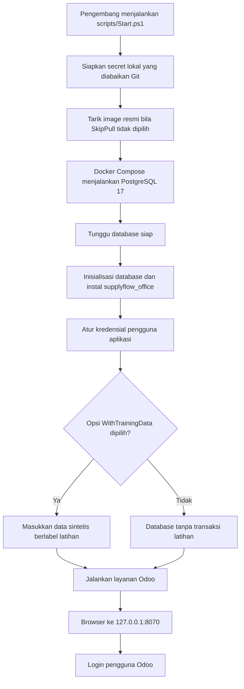
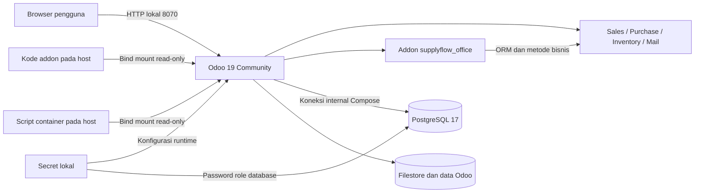

# Alur SupplyFlow Office

Diagram ini menjelaskan rancangan proses dan batas tanggung jawabnya. Status hasil pengujian harus dibaca dari catatan verifikasi implementasi, bukan dari keberadaan diagram.

## Permintaan pembelian sampai RFQ

Pengaju dapat membatalkan draft, pengajuan yang masih menunggu, atau permintaan yang ditolak. Pembatalan setelah persetujuan memerlukan penyetuju independen; pelaksana dan waktu dicatat pada riwayat. Dokumen yang sudah menghasilkan RFQ tidak dibatalkan lewat alur permintaan; petugas pembelian mengelola RFQ/PO tertaut menurut status dan izin Odoo.

Persetujuan mengizinkan pembuatan RFQ dari permintaan. Persetujuan itu tidak memesan barang, menerima barang, atau membayar pemasok. RFQ tetap dapat diperbarui di Purchase, sehingga estimasi permintaan bukan kontrol atas seluruh perubahan harga RFQ.

## Receipt bermasalah dan retur pemasok

Pembuatan picking retur dan validasi picking merupakan dua tindakan terpisah. Retur yang masih menunggu validasi belum membuktikan bahwa barang sudah dikirim balik. Catatan penyelesaian shortage tidak otomatis membuat refund, credit note, atau jurnal.

Kasus tidak mempunyai alur tolak/reset ke draft. Pelapor atau anggota Approver dapat membatalkan kasus pada status yang diizinkan. Pembatalan kasus yang sudah disetujui memerlukan grup Approver, tetapi aksi pembatalan ini tidak menerapkan pemeriksaan reviewer independen. Kasus yang sudah diterima penyelesaiannya atau menghasilkan picking retur tidak dibatalkan lewat alur kasus.

## Penjualan dan pengiriman

Alur ini memakai Sales dan Inventory standar. Addon permintaan/masalah penerimaan tidak mengganti perhitungan stok, reservasi, lokasi, atau aturan backorder Odoo.

## Pembelian dan penerimaan

Jumlah yang kurang masih dapat dikelola melalui backorder native. Kasus shortage merupakan catatan penanganan masalah dan keputusan; kasus itu tidak mengubah kuantitas barang yang sebenarnya diterima.

## Setup lokal dan komponen

PostgreSQL tidak mempunyai port host pada rancangan lokal ini. Database memuat data terstruktur, sedangkan filestore menyimpan berkas seperti lampiran. Cadangan harus mempertahankan keduanya dari keadaan yang konsisten.
