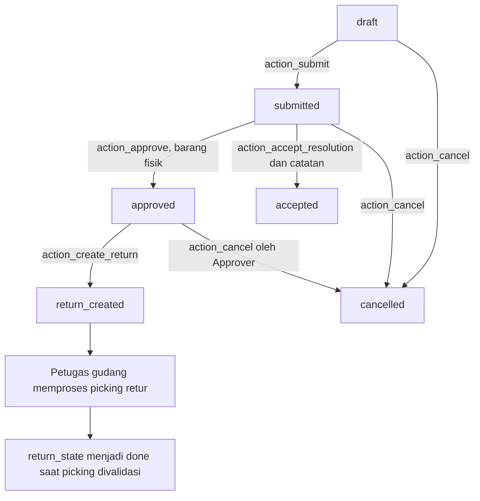

# 04. Membuat kasus penerimaan barang dan retur pemasok

Bab ini menambahkan penanganan barang rusak, barang salah, dan kekurangan jumlah pada receipt yang sudah selesai. Hasilnya adalah dua model baru, `supplyflow.issue` dan `supplyflow.issue.line`, serta satu perluasan kecil pada `stock.move`.

Contoh bisnisnya: gudang telah mencatat penerimaan 10 karton kertas, tetapi 3 karton rusak. Pelapor mencatat kasus, orang lain meninjaunya, lalu addon membuat dokumen retur Odoo sebanyak 3 karton. Petugas gudang memeriksa dan memvalidasi retur itu. Stok berkurang pada validasi gudang, bukan pada persetujuan kasus.

Bab ini mengikuti kode proyek yang sudah ada. Setiap blok berlabel **potongan kode** mengambil bagian dari file tersebut; blok itu bukan isi file lengkap. Saat menulis ulang, masukkan setiap bagian ke kelas yang disebutkan, tanpa menggandakan definisi metode. [File sumber lengkap](../../addons/supplyflow_office/models/supplier_issue.py) menjadi pembanding terakhir sebelum memperbarui addon.

## 1. Siapkan file yang akan saling terhubung

Lanjutkan setelah kerangka addon dan rancangan permintaan pembelian sudah terbentuk. Anda memakai Odoo Community 19 yang sama dengan proyek ini. Jika menulis ulang dari folder kosong, kumpulkan seluruh model, security, view, dan asset terlebih dahulu; instalasi lengkap serta data latihan dilakukan pada bab 05. Untuk mencoba UI sambil membaca bab ini, gunakan salinan proyek referensi yang sudah lengkap. Urutan susunan file pada bab ini:

| File | Yang ditambahkan | Cara Odoo memakainya |
| --- | --- | --- |
| [models/supplier_issue.py](../../addons/supplyflow_office/models/supplier_issue.py) | `SupplyflowIssue`, `SupplyflowIssueLine`, dan perluasan `StockMove` | ORM mendaftarkan model dan menjalankan aturan bisnis Python |
| [models/__init__.py](../../addons/supplyflow_office/models/__init__.py) | Import `supplier_issue` | Membuat file Python tersebut ikut dimuat |
| [data/sequences.xml](../../addons/supplyflow_office/data/sequences.xml) | Sequence `supplyflow.issue` | Memberikan nomor kasus `ISS/tahun/nomor` |
| [security/ir.model.access.csv](../../addons/supplyflow_office/security/ir.model.access.csv) | ACL untuk kedua model baru | Memberi anggota addon izin operasi model |
| [security/company_rules.xml](../../addons/supplyflow_office/security/company_rules.xml) | Rule perusahaan untuk kasus dan baris | Membatasi record pada perusahaan aktif yang diizinkan |
| [views/supplier_issue_views.xml](../../addons/supplyflow_office/views/supplier_issue_views.xml) | List, form, search, dan window action | Menghubungkan tombol layar dengan metode Python |
| [__manifest__.py](../../addons/supplyflow_office/__manifest__.py) | Memuat file security/data/view dalam urutan yang sesuai | Memasang data dan antarmuka addon |
| [tests/test_supplier_issue.py](../../addons/supplyflow_office/tests/test_supplier_issue.py) | Tes transaksi kasus dan retur | Memeriksa aturan di server dan hubungan dengan stok native |

Path pada tabel relatif terhadap `addons/supplyflow_office`. Seluruh bagian harus terpasang bersama sebelum alur digunakan. Menambahkan tombol lebih dahulu sementara metode/ACL belum tersedia akan menghasilkan error saat instalasi atau saat tombol dipakai.

Pada `models/__init__.py`, baris import yang diperlukan sudah berbentuk berikut. Ini **potongan kode**; pertahankan import model lain yang sudah ada:

```python
from . import supplier_issue
```

## 2. Tentukan receipt, move, dan kasus sebagai objek berbeda

`stock.picking` adalah satu dokumen perpindahan, misalnya satu receipt. `stock.move` adalah baris perpindahan suatu produk pada dokumen itu. `stock.quant` menyimpan kuantitas per produk/lokasi dan dimutakhirkan oleh mesin Inventory. Model kasus menunjuk receipt serta move sumber; model kasus tidak mengubah `stock.quant` secara langsung.

Satu receipt dapat berisi beberapa produk. Karena itu, baris kasus memakai `move_id`, bukan hanya `product_id`. Hubungan ke move membuktikan barang mana yang benar-benar diterima, satuannya apa, dan retur mana yang terkait sumber yang sama.

Di bagian atas `models/supplier_issue.py`, masukkan import lalu kelas parent berikut. Ini **potongan kode dari awal file**, sebelum deklarasi field:

```python
from datetime import timedelta
from math import isfinite

from odoo import _, api, fields, models
from odoo.exceptions import AccessError, UserError, ValidationError
from odoo.tools.float_utils import float_compare, float_round


class SupplyflowIssue(models.Model):
    _name = "supplyflow.issue"
    _description = "Supplier Receipt Issue"
    _inherit = ["mail.thread", "mail.activity.mixin"]
    _order = "create_date desc, id desc"
    _check_company_auto = True
```

`_name` membuat model custom baru. `_inherit` di sini menambahkan chatter dan aktivitas. `_check_company_auto` membantu pemeriksaan hubungan beratribut `check_company=True`. Ketiganya mempunyai tugas berbeda; keamanan metode tetap harus ditulis.

Tambahkan field di dalam kelas tersebut dengan memakai definisi lengkap dari file sumber. Kelompokkan saat membaca atau menulisnya:

| Kelompok | Field | Keterangan |
| --- | --- | --- |
| Identitas | `name`, `company_id`, `requester_id` | Nomor sequence, perusahaan, dan pelapor dari pengguna yang sedang login |
| Sumber | `picking_id` | Receipt incoming berstatus `done`, dengan hubungan perusahaan yang diperiksa |
| Masalah | `reason`, `description`, `line_ids` | Jenis masalah, uraian wajib, dan barang yang terdampak |
| Penanggung jawab | `resolver_id`, `resolution_due` | Pengguna internal yang memiliki akses perusahaan dan tenggat, default tujuh hari |
| Keputusan | `state`, `approved_by_id`, `approved_at`, `resolution_note` | Status kasus, pelaksana/waktu review, dan catatan penyelesaian |
| Retur tertaut | `return_picking_id`, `return_state` | Dokumen retur native dan status terkaitnya |

`resolver_id` adalah penugasan tanggung jawab. Field ini tidak memberi hak Approver dan tidak membuat hanya resolver yang dapat meninjau kasus. Pemeriksaan review memakai kelompok serta identitas pelapor.

**Potongan kode** untuk field sumber, diletakkan di dalam `SupplyflowIssue`:

```python
    picking_id = fields.Many2one(
        "stock.picking", string="Received shipment", required=True,
        check_company=True, ondelete="restrict", tracking=True,
        domain="[('state', '=', 'done'), ('picking_type_code', '=', 'incoming'), ('company_id', '=', company_id)]",
    )
```

`domain` mempersempit pilihan pada form. Domain bukan pemeriksaan akhir: pemanggil RPC dapat mengirim ID tanpa memakai pilihan form. Metode `_check_receipt()` di langkah 5 memeriksa sumber lagi pada server.

## 3. Susun status sebelum menulis tombol

Gunakan nama teknis status berikut, persis seperti nilai `Selection` pada model:



Kasus tidak memiliki status `rejected` atau aksi reset ke draft. Setelah pengajuan, isi pokok dan baris dibekukan. Jika kasus keliru dan masih berada pada status yang mengizinkan pembatalan, batalkan lalu buat kasus baru yang benar.

`state` dan `return_state` harus dibedakan. Setelah retur divalidasi, `state` kasus tetap `return_created`, sedangkan `return_state` terkait berubah menjadi `done`. Jika picking retur dibatalkan dari Inventory, `return_state` menjadi `cancel`; kasus tetap menyimpan hubungan yang sama.

## 4. Lindungi perubahan sebelum menambahkan aksi review

Di bawah field, masukkan `_protected_fields` dan `_content_fields` dari sumber. Set pertama melindungi nomor, status, identitas pelapor, metadata review, tautan retur, dan field audit ORM. Set kedua menentukan isi yang hanya boleh berubah pada draft milik pelapor.

Lalu tambahkan helper akses berikut di dalam `SupplyflowIssue`. Tabel ini merupakan inventaris seluruh helper parent; baca implementasinya pada file sumber ketika menyusunnya.

| Metode | Input | Hasil atau penolakan | Mengapa diperlukan |
| --- | --- | --- | --- |
| `_check_member()` | Pengguna environment saat ini | Selesai tanpa nilai khusus, atau `AccessError` | Anggota kelompok SupplyFlow saja yang boleh memakai aksi kasus |
| `_check_approver()` | Pengguna saat ini | Memeriksa keanggotaan addon lalu kelompok Approver | Memisahkan hak pelapor dan peninjau |
| `_check_draft_owner()` | Recordset kasus | Memeriksa akses tulis, `draft`, dan `requester_id` | Anggota lain tidak boleh mengubah draft pelapor |
| `_check_independent_reviewer()` | Kasus dan pengguna saat ini | Memeriksa Approver, menolak jika pengguna adalah pelapor | Pelapor yang juga Approver tetap perlu orang lain untuk review |
| `_lock()` | Recordset kasus | Memeriksa akses, row lock, membuang cache, lalu memeriksa akses kembali | Membaca status terbaru setelah persaingan transaksi |
| `_transition(values)` | Dictionary field workflow yang sudah diotorisasi | Hasil `super(...).write(values)` | Jalur internal perubahan status melewati override `write()` yang melarang perubahan langsung |

**Potongan kode** helper lock dari kelas parent:

```python
    def _lock(self):
        self.check_access("write")
        self.lock_for_update()
        self.invalidate_recordset()
        self.check_access("write")
```

`invalidate_recordset()` membuang nilai cache ORM agar pemeriksaan setelah lock tidak bergantung pada nilai yang dibaca sebelumnya. Lock tidak memberikan hak akses tambahan. Metode private berawalan `_` dipakai dari jalur Python internal; browser memakai metode publik `action_*` yang mengulang pemeriksaan bisnis.

Tambahkan override `create`, `write`, dan `unlink` berikut **secara lengkap dari sumber**, masih pada kelas parent:

| Metode | Langkah yang harus dipertahankan |
| --- | --- |
| `create(vals_list)` | Memeriksa anggota; menolak status/pelapor/metadata audit yang dipalsukan; memberi sequence, pelapor, status draft, dan perusahaan; membersihkan `default_*` untuk field terlindungi; meneruskan pembuatan ke ORM |
| `write(vals)` | Menolak field terlindungi; mengunci saat isi/catatan berubah; membatasi isi pada draft pelapor; mengizinkan catatan draft oleh pelapor atau catatan submitted oleh reviewer independen; menolak perubahan catatan setelah review selesai |
| `unlink()` | Mengunci, memeriksa draft milik pelapor, lalu menghapus melalui ORM |

`readonly=True` di deklarasi field dan XML membantu form, tetapi tidak cukup untuk menolak `write({"state": "approved"})` lewat RPC. Override tersebut yang menolak perubahan itu. Penghapusan `default_state`, `default_approved_by_id`, dan default terlindungi lain juga mencegah pemanggil mengisi metadata review melalui context.

ACL tetap memberi anggota addon izin CRUD pada model; metode Python mempersempit operasi menurut pemilik dan status. Record rule perusahaan membatasi record yang boleh diakses. Pengguna dapat membaca kasus perusahaan aktif yang diizinkan untuk koordinasi; membaca kasus bukan berarti dapat mengeditnya.

## 5. Validasi receipt dan baris di server

Tambahkan `_check_receipt()` dan `_check_lines()` setelah override parent. Keduanya dipanggil ulang oleh aksi workflow.

`_check_receipt()` memiliki decorator `@api.constrains("picking_id", "company_id", "resolver_id", "description")`. Metode memeriksa akses baca receipt, status `done`, jenis `incoming`, perusahaan yang sama, resolver internal yang memiliki perusahaan itu, serta uraian yang tidak kosong/berisi spasi saja. Bila baris sudah ada, semua move harus berasal dari receipt terpilih.

`_check_lines(returning=False)` memanggil pemeriksaan receipt, mewajibkan sedikitnya satu baris, lalu memanggil validasi move pada baris. Jika kasus akan diretur, atau alasannya bukan shortage, jumlah juga dibandingkan dengan sisa yang dapat diretur. `float_compare` memakai pembulatan satuan sumber; jangan menggantinya dengan pembandingan float tanpa ketelitian satuan.

**Potongan kode** dari `_check_lines()` yang membedakan shortage:

```python
            if returning and issue.reason == "shortage":
                raise UserError(_("Missing goods cannot be returned. Resolve a shortage with a review note."))
            if returning or issue.reason != "shortage":
                for line in issue.line_ids:
                    remaining = line._remaining_returnable_quantity()
```

Untuk shortage, `affected_qty` mencatat jumlah yang kurang. Jumlah itu tetap harus positif dan memiliki move sumber yang sah, tetapi tidak dibatasi oleh sisa jumlah retur. Barang yang belum datang tidak mempunyai barang fisik untuk dikirim kembali. Contoh: pesanan 20, diterima 12, kekurangan 8. Penerimaan 12 tetap benar, backorder native dapat mengelola 8 yang ditunggu, dan kasus shortage mencatat tindak lanjut pemasok.

Keterbatasan model saat ini: kasus membutuhkan receipt selesai dan move sumber selesai. Kasus ini tidak mencakup keluhan sebelum ada receipt selesai atau SKU yang tidak memiliki move selesai pada receipt terpilih.

## 6. Tambahkan aksi pengajuan, review, dan pembatalan

Letakkan metode aksi pada `SupplyflowIssue`, setelah helper validasi. Form memanggilnya menggunakan tombol `type="object"`.

### Pengajuan

Berikut **satu metode lengkap** dari file sumber; masukkan satu kali pada kelas parent:

```python
    def action_submit(self):
        self.ensure_one()
        self._check_draft_owner()
        self._lock()
        self._check_draft_owner()
        self._check_lines()
        self._transition({"state": "submitted"})
        self.message_post(body=_("Supplier issue submitted for independent review."))
        return True
```

`ensure_one()` mensyaratkan satu kasus. Pemeriksaan draft diulang setelah lock karena transaksi lain mungkin sudah mengubah status. Hasil `True` berarti aksi selesai; pesan chatter memberi catatan pengajuan, sedangkan pelarangan edit datang dari pemeriksaan Python.

### Keputusan

Tambahkan metode berikut dari sumber. Tidak ada parameter formulir tambahan; metode membaca field record yang sudah disimpan dan identitas environment Odoo.

| Metode | Syarat | Perubahan | Hasil |
| --- | --- | --- | --- |
| `action_approve()` | Reviewer independen, kasus `submitted`, baris layak retur, bukan shortage | `approved`, `approved_by_id`, `approved_at`, pesan chatter | `True`; belum ada picking baru |
| `action_accept_resolution()` | Reviewer independen, kasus `submitted`, baris valid, `resolution_note` tidak kosong | `accepted`, reviewer/waktu, pesan chatter | `True`; tanpa perpindahan stok |
| `action_cancel()` | Anggota addon, status draft/submitted/approved, pelapor atau Approver; status approved memerlukan Approver | `cancelled` | `True`; pemanggilan ulang pada cancelled juga `True` |

Penyelesaian tanpa retur juga boleh digunakan untuk barang rusak/salah bila ada kesepakatan yang dicatat. Untuk shortage, inilah jalur keputusan yang tersedia. Catatan tidak otomatis membuat kiriman pengganti, refund, credit note, atau jurnal akuntansi.

Pembatalan kasus yang sudah disetujui memerlukan kelompok Approver; kode pembatalan tidak mengulang syarat reviewer berbeda dari pelapor. Pemeriksaan independen berlaku pada `action_approve()` dan `action_accept_resolution()`. Kasus `accepted` atau `return_created` tidak dapat dibatalkan melalui tombol kasus. Picking yang sudah ada dikelola melalui aturan Inventory native.

## 7. Buat kelas baris di bawah kelas parent

Setelah metode terakhir `SupplyflowIssue`, tulis kelas `SupplyflowIssueLine(models.Model)` dengan `_name = "supplyflow.issue.line"`. Kelas ini masih berada pada file `supplier_issue.py`, tanpa indentasi di bawah kelas parent.

Masukkan field lengkap dari sumber: `issue_id`, perusahaan/sumber terkait, `move_id`, produk/satuan terkait, `affected_qty`, dan `returnable_qty`. `product_id` serta `product_uom_id` berasal dari `move_id`; pengguna tidak boleh memasangkan move kertas dengan identitas produk lain.

Tambahkan constraint database berikut. Ini **potongan kode** pada kelas baris:

```python
    _unique_issue_move = models.Constraint("UNIQUE(issue_id, move_id)", "Add each received product only once per issue.")
```

Constraint mencegah move yang sama muncul dua kali dalam satu kasus. Tanpanya, dua baris untuk sumber yang sama dapat membuat pemetaan jumlah pada wizard ambigu.

Tambahkan `_derived_fields` lalu metode berikut dari file lengkap:

| Metode | Input dan hasil | Mengapa ada |
| --- | --- | --- |
| `_validated_quantity_input(value)` | Mengubah masukan menjadi float positif, finite, dan dapat diproses menurut precision `Product Unit`; mengembalikan nilai atau `ValidationError` | Menolak teks, NaN, infinity, angka terlalu besar, nol, atau negatif sebelum konversi field ORM |
| `_check_source_move()` | Memeriksa move dapat dibaca, `done`, berasal dari receipt kasus, perusahaan sama, serta jumlah positif pada pembulatan satuan | Memvalidasi relasi dan jumlah di server, termasuk setelah perubahan baris |
| `create(vals_list)` | Mengambil parent dari nilai/context yang sah, memastikan parent ada, mengunci parent dan memeriksa draft pemilik, menolak derived field, memvalidasi jumlah, membersihkan default derived | Melindungi pembuatan baris langsung lewat RPC maupun One2many |
| `write(vals)` | Mengunci parent dan memeriksa draft pemilik; melarang pindah parent, melarang derived field, memvalidasi perubahan jumlah | Pengguna tidak dapat mengubah kasus submitted melalui model baris |
| `unlink()` | Mengunci dan memeriksa draft pemilik sebelum penghapusan | Membekukan penghapusan baris setelah pengajuan |
| `_compute_returnable_qty()` | Menghitung `returnable_qty` setiap dependency move/retur berubah | Memberi angka bantuan pada form; validasi aksi tetap menghitung ulang |
| `_remaining_returnable_quantity()` | Mengembalikan sisa dalam satuan move sumber | Membatasi jumlah yang dapat dipakai kasus retur baru |

`_check_source_move()` menggunakan `float_compare(..., precision_rounding=...)` selain pemeriksaan awal `_validated_quantity_input()`. Angka yang secara Python lebih besar dari nol tetapi menjadi nol pada ketelitian satuan tetap ditolak.

## 8. Hitung sisa retur dari sumber yang sama

Masukkan **metode lengkap berikut** pada `SupplyflowIssueLine`, sesuai file sumber:

```python
    def _remaining_returnable_quantity(self):
        self.ensure_one()
        source = self.move_id
        # Count all returns of an authorized source, even if a custom stock rule hides a sibling transfer.
        returned = self.env["stock.move"].sudo().search([
            ("origin_returned_move_id", "=", source.id), ("company_id", "=", source.company_id.id),
            ("state", "!=", "cancel"),
        ])
        committed = sum(
            move.product_uom._compute_quantity(
                move.quantity if move.state == "done" else move.product_uom_qty, source.product_uom,
                round=False,
            ) for move in returned
        )
        return max(0.0, source.quantity - committed)
```

Metode menghitung semua retur yang menunjuk `origin_returned_move_id` sumber tersebut: retur yang dibuat addon maupun retur manual melalui Inventory. Retur `done` memakai jumlah aktual `quantity`; retur yang belum selesai memakai jumlah rencana `product_uom_qty` sebagai komitmen. Retur berstatus `cancel` tidak mengurangi sisa. Konversi satuan menyamakan semua jumlah ke satuan move sumber sebelum penjumlahan.

`sudo()` di sini dibatasi pada pembacaan retur dari sumber/perusahaan yang sudah diotorisasi oleh pemeriksaan pemanggil. Tujuannya agar aturan stock tambahan yang menyembunyikan retur lain tidak menyebabkan batas jumlah terhitung terlalu besar. Kode tidak mengirim daftar retur tersembunyi ke pengguna, tidak memberi `sudo()` pada seluruh kasus, dan tidak membuat picking dengan izin yang ditingkatkan.

Contoh hitungan, semuanya dalam karton:

| Kejadian | Sisa untuk kasus retur baru | Stok gudang jika tidak ada transaksi lain |
| --- | ---: | ---: |
| Receipt selesai menerima 10 | 10 | 10 |
| Kasus A disetujui untuk 7, belum membuat picking | 10 | 10 |
| Kasus B disetujui untuk 4, belum membuat picking | 10 | 10 |
| A membuat picking retur 7, belum divalidasi | 3 | 10 |
| B mencoba membuat picking 4 | Ditolak karena hanya 3 tersisa | 10 |
| Gudang memvalidasi retur A sebanyak 7 | 3 | 3 |

Persetujuan kasus belum mereservasi batas kuantitas pada metode ini. Pembuatan picking non-cancel yang menambah komitmen. Pemeriksaan diulang saat membuat retur, sehingga dua kasus yang sebelumnya sama-sama disetujui belum tentu sama-sama dapat membuat picking.

`returnable_qty` mengukur sisa hak retur terhadap receipt sumber, bukan stok fisik yang tersedia di lokasi sekarang. Barang mungkin sudah dijual atau dipindahkan. Reservasi, lokasi, lot/serial, dan validasi stok tetap mengikuti Inventory native.

## 9. Buat picking melalui wizard Odoo

Kembali ke kelas parent `SupplyflowIssue`. Tambahkan `_return_action()` dan `action_open_return()` sebelum `action_create_return()`.

`_return_action()` memeriksa akses baca picking lalu mengembalikan dictionary window action dengan `res_model="stock.picking"` dan `res_id` retur tertaut. `action_open_return()` memeriksa anggota/akses baca kasus, menolak jika belum ada retur, lalu memakai helper tersebut. Keduanya membuka dokumen yang sudah ada; tidak membuat stok baru.

Berikut **metode lengkap** pembuat retur dari sumber. Tempatkan satu kali di dalam `SupplyflowIssue`:

```python
    def action_create_return(self):
        self.ensure_one()
        self._check_approver()
        self._lock()
        if self.return_picking_id:
            return self._return_action()
        if self.state != "approved":
            raise UserError(_("Approve the supplier issue before creating a return transfer."))
        moves = self.line_ids.move_id.sorted("id")
        moves.check_access("write")
        moves.lock_for_update()
        moves.invalidate_recordset()
        self._check_lines(returning=True)
        # Updating a source revision makes stale repeatable-read transactions retry safely.
        moves._supplyflow_advance_return_revision()
        wizard = self.env["stock.return.picking"].with_context(
            {}, allowed_company_ids=self.env.companies.ids, lang=self.env.lang, tz=self.env.user.tz,
            active_model="stock.picking", active_id=self.picking_id.id, active_ids=self.picking_id.ids,
        ).create({"picking_id": self.picking_id.id})
        quantities = {line.move_id.id: line.affected_qty for line in self.line_ids}
        for return_line in wizard.product_return_moves:
            return_line.quantity = quantities.get(return_line.move_id.id, 0.0)
        action = wizard.action_create_returns()
        picking = self.env["stock.picking"].browse(action["res_id"])
        self._transition({"return_picking_id": picking.id, "state": "return_created"})
        self.message_post(body=_("Supplier return transfer created. Stock changes only when the warehouse validates it."))
        return self._return_action()
```

Baca metode itu dalam urutan pelaksanaannya:

1. Metode mensyaratkan Approver, mengunci kasus, dan membuka retur yang sama jika sudah tertaut. Ini membuat klik ulang tidak menambah retur kedua untuk kasus yang sama.
2. Untuk pembuatan baru, kasus harus `approved`. Metode mengurutkan dan mengunci move sumber, memeriksa akses tulis, serta menghitung ulang sisa. Dua kasus berbeda dapat memakai sumber yang sama, sehingga lock parent kasus saja belum cukup.
3. Metode menaikkan revisi move sumber. Penjelasan transaksi ada di langkah berikut.
4. `with_context({}...)` memulai context wizard yang bersih, kemudian meneruskan perusahaan yang diizinkan, bahasa, zona waktu, dan receipt aktif yang benar. Default `picking_id` atau baris wizard yang disisipkan pemanggil tidak boleh mengganti barang yang telah disetujui.
5. `stock.return.picking` adalah wizard sementara native. Addon mengisi `product_return_moves`: jumlah baris yang terdampak mengikuti kasus, semua baris lain menjadi nol.
6. `wizard.action_create_returns()` membuat dokumen native. Hasilnya window action; addon mengambil `action["res_id"]`, menautkannya ke kasus, lalu mengembalikan action untuk membuka form retur.

Pada [sumber wizard Odoo 19](https://github.com/odoo/odoo/blob/19.0/addons/stock/wizard/stock_picking_return.py), `action_create_returns()` menghasilkan action `stock.picking`; proses pembuatannya mengonfirmasi dan mencoba mereservasi transfer. Addon memakai API versi ini. Jangan mengganti nama metode dengan contoh versi Odoo lain tanpa memeriksa sumber yang sesuai.

Tidak ada pemanggilan `button_validate()` di metode addon tersebut. Pembuatan dokumen dan upaya reservasi native belum mengurangi on-hand. Petugas gudang tetap harus memeriksa operasi dan jumlah sebelum memvalidasi picking. Approver juga memerlukan hak Inventory native yang sesuai; kelompok SupplyFlow saja tidak memberikan seluruh hak stok.

## 10. Tambahkan revisi sumber untuk transaksi bersamaan

Di bagian paling bawah file, setelah kelas baris, tambahkan perluasan `stock.move` berikut. Ini **kelas lengkap dari sumber**:

```python
class StockMove(models.Model):
    _inherit = "stock.move"

    supplyflow_return_revision = fields.Integer(default=0, readonly=True, copy=False)

    def write(self, vals):
        if "supplyflow_return_revision" in vals:
            raise AccessError(_("Supplier return revisions are managed by the issue workflow."))
        return super().write(vals)

    def _supplyflow_advance_return_revision(self):
        for move in self:
            super(StockMove, move).write({"supplyflow_return_revision": move.supplyflow_return_revision + 1})
```

`_inherit = "stock.move"` memperluas model native yang sudah ada; tidak menamai model baru. Field integer tambahan ini tidak menyimpan jumlah barang. Nilainya menandai perubahan sumber ketika alur addon menciptakan komitmen retur baru.

Lock mengendalikan akses serentak pada baris. Namun transaksi Odoo/PostgreSQL dapat memiliki snapshot baca yang lebih lama. Perubahan revisi memaksa perubahan nyata pada row sumber, sehingga konflik transaksi yang basi dapat dideteksi dan ditangani oleh mekanisme transaksi/RPC Odoo. Setelah percobaan ulang yang berhasil memperoleh keadaan terbaru, pemeriksaan sisa kuantitas tetap wajib berjalan. Lock/retry tidak menggantikan validasi jumlah.

Override `write()` menolak masukan revisi dari pemanggilan biasa. Helper private menaikkan angka melalui `super(StockMove, move).write(...)` pada jalur internal yang telah memeriksa kasus dan sumber. Flag context buatan pengguna tidak membuka field tersebut.

Jaminan ini mempunyai batas: alur addon saling mengoordinasikan kasus yang membuat retur melalui `action_create_return()`. Kode tidak mengganti semua jalur retur manual Odoo menjadi wajib persetujuan SupplyFlow. Perhitungan membaca retur manual yang sudah ada, tetapi jangan mengklaim addon mengendalikan seluruh modifikasi Inventory atau semua persaingan dengan kode modul lain.

## 11. Hubungkan tombol, ACL, sequence, dan manifest

Salin definisi lengkap dari [supplier_issue_views.xml](../../addons/supplyflow_office/views/supplier_issue_views.xml) ke file view yang sama pada proyek latihan. Di dalam form, tombol berikut merupakan **potongan XML** yang memanggil metode pengajuan:

```xml
<button name="action_submit" type="object" string="Submit for review" class="oe_highlight" invisible="state != 'draft'"/>
```

`name` harus sama dengan nama metode Python. `type="object"` memanggil model record aktif. `invisible` menyesuaikan layar; server tetap memeriksa status/pemilik. Tombol review juga memakai `groups` dan kondisi `requester_id != uid` untuk membantu pengguna menemukan aksi yang boleh dipakai.

Form mengatur isi/baris readonly di luar draft, menampilkan pemberitahuan shortage, menampilkan peringatan bahwa picking baru belum mengubah stok, serta menyediakan smart button `Supplier return`. `duplicate="false"` mencegah alur salin form yang tidak disediakan untuk data sumber/audit ini.

Search view memberi filter pelapor, menunggu review, approved, unresolved, tenggat lewat, dan menunggu gudang. Filter menunggu gudang memerlukan `state="return_created"` dan status picking bukan `done`/`cancel`. Filter overdue melihat kasus `submitted`/`approved` yang melewati `resolution_due`.

Pada [sequences.xml](../../addons/supplyflow_office/data/sequences.xml), record `sequence_issue` memakai code `supplyflow.issue`, prefix `ISS/%(year)s/`, dan padding 5. Code itu harus sama dengan argumen `next_by_code("supplyflow.issue")` pada `create()`.

Pastikan dua ACL model kasus/baris serta dua record rule perusahaan sudah ditambahkan. Manifest memuat security lebih dahulu, kemudian sequence, kemudian view; [menus.xml](../../addons/supplyflow_office/views/menus.xml) menghubungkan menu kasus ke `action_issues`. Pada proyek yang dibangun ulang, tunggu sampai susunan lengkap pada bab 05 sebelum memasang addon. Pada proyek referensi yang sudah lengkap, pembaruan mengikuti prosedur [OPERATIONS](../OPERATIONS.md#memperbarui-kode-addon). Menyegarkan browser saja tidak memasang field atau XML yang baru.

## 12. Periksa alur melalui UI dan tes

Lakukan pemeriksaan ini pada proyek referensi lengkap yang sudah berjalan, atau setelah instalasi lengkap pada bab 05. Gunakan data latihan atau data sintetis sendiri. Siapkan dua akun berbeda: pelapor dengan akses SupplyFlow/Inventory yang sesuai, dan reviewer dengan kelompok Approver serta hak Inventory. Password latihan dibaca dari file kredensial lokal, bukan ditulis ke dokumentasi atau test.

1. Selesaikan satu receipt incoming, misalnya 10 karton. Catat on-hand awal pada produk/lokasi yang dipakai.
2. Sebagai pelapor, buka SupplyFlow > Supplier issues, buat kasus, pilih receipt tersebut, isi alasan/uraian/resolver/tenggat, lalu pilih move dan jumlah 3.
3. Simpan lalu pilih **Submit for review**. Pastikan kasus `submitted` dan isi/baris tidak dapat diedit.
4. Masuk sebagai reviewer lain, pilih **Approve supplier return**. Pastikan `approved`, reviewer/waktu terisi, dan stok belum berubah.
5. Pilih **Create return transfer**. Pastikan form picking native terbuka, jumlah rencana 3, dan sumber menunjuk receipt asli. On-hand masih sama sebelum validasi.
6. Buka kasus lagi dan gunakan **Supplier return**. Picking yang terbuka harus sama, bukan picking kedua.
7. Petugas gudang memeriksa barang/jumlah lalu memvalidasi picking. Untuk contoh tanpa transaksi lain, on-hand 10 menjadi 7; `return_state` menjadi `done`.
8. Ulangi dengan alasan **Quantity shortage**. Review harus melalui **Resolve without return** dengan catatan. Pastikan kasus `accepted` dan tidak memiliki picking retur.

Tambahkan [test_supplier_issue.py](../../addons/supplyflow_office/tests/test_supplier_issue.py) ke paket [tests/__init__.py](../../addons/supplyflow_office/tests/__init__.py). Tes memakai `TransactionCase` Odoo, bukan Python kosong. Fixture `_make_receipt()` membuat transfer native, menulis jumlah aktual pada move, lalu memvalidasi receipt sungguhan.

| Tes yang dibaca | Perilaku yang dibuktikan |
| --- | --- |
| `test_independent_approval_creates_native_return_without_moving_stock` | Hubungan picking/move benar, pembuatan retur belum mengurangi on-hand, validasi menguranginya |
| `test_return_creation_is_idempotent` | Klik/panggil ulang mengembalikan retur yang sama dan revisi naik satu kali |
| `test_existing_pending_returns_reserve_their_quantity` | Dua kasus approved tetap diperiksa ulang ketika mulai membuat picking |
| `test_native_pending_return_is_included_in_returnability` | Retur manual native yang masih menunggu juga dihitung |
| `test_cancelled_return_does_not_consume_returnable_quantity` | Retur dibatalkan tidak menghabiskan sisa batas |
| `test_reporter_cannot_approve_or_create_return`, `test_approver_cannot_approve_own_issue` | Hak kelompok dan independensi review diperiksa di server |
| `test_direct_state_and_review_writes_cannot_bypass_workflow`, `test_context_defaults_cannot_seed_review_or_forge_audit` | `write`/context tidak dapat memalsukan keputusan |
| `test_line_defaults_cannot_replace_derived_receipt_details`, `test_return_wizard_context_cannot_replace_approved_goods` | Identitas barang dan sumber wizard tidak dapat diganti melalui default context |
| `test_submitted_issue_and_lines_are_frozen`, `test_another_reporter_cannot_edit_draft_or_reparent_line` | Pembekuan dan kepemilikan berlaku juga pada akses langsung model baris |
| `test_invalid_source_and_nonpositive_quantity_are_rejected`, `test_invalid_numeric_inputs_are_rejected_before_field_conversion` | Sumber salah dan angka tidak valid ditolak |
| `test_empty_or_excessive_issue_cannot_be_submitted` | Kasus kosong atau retur melampaui sisa tidak bisa diajukan |
| `test_shortage_requires_written_nonreturn_resolution` | Shortage memerlukan catatan, tanpa picking baru, dan catatan keputusan dibekukan |
| `test_issue_company_must_match_received_shipment`, `test_source_revision_cannot_be_forged` | Pembatas perusahaan dan revisi sumber tetap berlaku |
| `test_only_reporter_or_approver_can_cancel_open_issue` | Pembatalan mengikuti identitas/status dan tetap aman dipanggil ulang |

[test_distribution_flow.py](../../addons/supplyflow_office/tests/test_distribution_flow.py) melanjutkan pemeriksaan sampai PO, receipt parsial, backorder, retur, dan delivery pelanggan. [Tes browser](../../tests/browser/workflows.spec.js) juga memakai sesi HTTP terpisah untuk memeriksa kasus retur bersaing. Tes transaksi satu cursor saja tidak mewakili dua permintaan HTTP bersamaan.

## Jika hasilnya berbeda

| Gejala | Pemeriksaan |
| --- | --- |
| Receipt tidak muncul pada pilihan | Pastikan `done`, jenis incoming, dan perusahaan sesuai; receipt yang masih menunggu bukan sumber yang diizinkan |
| Produk tidak muncul pada baris kasus | Pilih move selesai dari receipt yang sama; nama produk yang sama pada receipt lain belum tentu move yang benar |
| Review ditolak walau akun Approver | Bandingkan akun reviewer dengan `requester_id`; penugasan resolver tidak menghapus syarat reviewer berbeda |
| Create return ditolak karena akses | Periksa hak native Inventory serta ACL/record rule, bukan hanya kelompok SupplyFlow |
| Jumlah yang kemarin tersedia sekarang ditolak | Periksa retur manual/pending dari sumber yang sama; pemeriksaan saat membuat picking membaca komitmen terbaru |
| Shortage tidak mempunyai tombol approve retur | Ini jalur yang diharapkan; isi catatan penyelesaian lalu selesaikan tanpa retur |
| Stok belum berkurang setelah membuat retur | Buka picking dan periksa statusnya; stok berkurang setelah gudang memvalidasi jumlah aktual |
| Kasus tetap `return_created` setelah picking selesai | Periksa `return_state`; kedua field memang menyatakan tahap dokumen yang berbeda |
| Kasus tidak dapat diedit setelah diajukan | Isi/baris memang dibekukan; gunakan pembatalan pada status yang diizinkan bila perlu membuat laporan pengganti |
| Field baru atau tombol tidak ditemukan | Periksa import Python, manifest, log update addon, dan hasil pemuatan XML sebelum mencoba ulang di browser |

Setelah bab ini, Anda dapat menjelaskan hubungan setiap lapisan: form memanggil `action_*`, metode memeriksa hak/status dan mengunci record, baris memvalidasi sumber serta batas jumlah, wizard native menghasilkan picking, dan Inventory memproses perpindahan stok saat validasi gudang.
