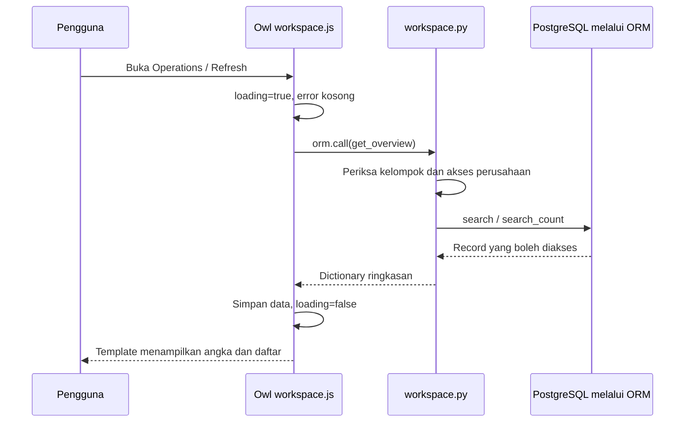

# 05. Membuat form, workspace, dan PDF

Bab ini menghubungkan model Python yang sudah dibuat dengan layar yang dipakai pengguna. Hasilnya terdiri dari form/daftar native Odoo, satu workspace Owl, dan laporan PDF QWeb. Model tetap memegang aturan bisnis; layar memanggil model tersebut.

Kerjakan pada salinan repo untuk belajar. Potongan di bawah diambil dari sumber proyek dan menunjukkan letak kode yang dibahas. Potongan bukan pengganti seluruh isi berkas. Tautan sumber lengkap disediakan agar penutupan tag, import, dan bagian lain tetap utuh.

Bab [02](02-kerangka-addon-dan-akses.md) memakai kerangka minimal agar addon pertama dapat dipasang. Sesudah mempelajari model lengkap pada bab [03](03-model-permintaan-dan-rfq.md) dan [04](04-receipt-masalah-dan-retur.md), gunakan versi lengkap manifest, import model, security, view, report, dan asset yang dirujuk bab ini. Muat seluruh rangkaian tersebut bersama sebelum memilih data latihan. View final merujuk field model final; memasangkan view final dengan model kerangka akan menghasilkan error field tidak ditemukan.

## 1. Kenali tiga jenis tampilan

| Jenis | Dipakai untuk | Sumber proyek |
| --- | --- | --- |
| View XML native | Daftar, form, pencarian, tombol, dan menu dokumen | [purchase_request_views.xml](../../addons/supplyflow_office/views/purchase_request_views.xml), [supplier_issue_views.xml](../../addons/supplyflow_office/views/supplier_issue_views.xml), [menus.xml](../../addons/supplyflow_office/views/menus.xml) |
| Komponen Owl | Ringkasan operasi yang mengambil data lewat RPC | [workspace.py](../../addons/supplyflow_office/models/workspace.py), [workspace.js](../../addons/supplyflow_office/static/src/workspace.js), [workspace.xml](../../addons/supplyflow_office/static/src/workspace.xml), [workspace.scss](../../addons/supplyflow_office/static/src/workspace.scss) |
| QWeb report | Dokumen ringkasan yang dapat dicetak menjadi PDF | [purchase_request_report.xml](../../addons/supplyflow_office/reports/purchase_request_report.xml) |

Satu berkas XML form dapat berisi beberapa record view dan action. Odoo menyimpan definisi tersebut dalam database saat addon dipasang atau diperbarui. Mengedit XML pada disk belum memperbarui definisi database yang sedang dipakai.

## 2. Daftarkan XML dan asset dalam manifest

Buka [__manifest__.py](../../addons/supplyflow_office/__manifest__.py). Bagian `data` memuat data XML/CSV secara berurutan. Pada proyek ini urutannya dimulai dari security, penomoran, kedua view, report, lalu menu. Menu diletakkan setelah action yang dirujuknya tersedia.

Bagian berikut berada setelah `data` di dictionary manifest. Ini satu entry dictionary, sehingga tidak dapat dijalankan sebagai file Python tersendiri. Pertahankan kurung kurawal pembuka/penutup dan entry lain pada manifest lengkap:

```python
    "assets": {
        "web.assets_backend": [
            "supplyflow_office/static/src/workspace.js",
            "supplyflow_office/static/src/workspace.xml",
            "supplyflow_office/static/src/workspace.scss",
        ],
    },
```

`web.assets_backend` adalah kumpulan asset untuk web client ERP setelah login. JavaScript, template Owl, dan SCSS workspace dimuat melalui kumpulan ini. File XML pada `static/src` berbeda jalur pemuatannya dari XML view dalam `data`.

Checkpoint: cocokkan semua path dengan nama berkas pada disk. Salah satu nama yang keliru dapat membuat asset gagal dibangun sebelum komponen tampil.

## 3. Buat daftar permintaan pembelian

Di [purchase_request_views.xml](../../addons/supplyflow_office/views/purchase_request_views.xml), record pertama adalah `view_request_list`. Bagian pembukanya:

```xml
    <record id="view_request_list" model="ir.ui.view">
        <field name="name">supplyflow.request.list</field>
        <field name="model">supplyflow.request</field>
        <field name="arch" type="xml">
            <list decoration-muted="state == 'cancelled'" decoration-danger="state == 'rejected'">
                <field name="name"/>
                <field name="requester_id"/>
                <field name="vendor_id"/>
```

Letakkan record view di dalam tag `<odoo>`, seperti pada sumber lengkap. `model="ir.ui.view"` membuat definisi view; field `model` di dalamnya menentukan model bisnis yang ditampilkan. `arch` menampung susunan layar.

Setiap `<field>` pada `<list>` menjadi kolom. Nama field harus sama dengan model Python. Kolom lain pada sumber menampilkan gudang, tanggal kebutuhan, estimasi, perusahaan, dan status. `sum="Estimated total"` menjumlahkan kolom estimasi pada daftar. `currency_id` disertakan untuk format monetary meskipun kolomnya disembunyikan.

`decoration-muted` dan `decoration-danger` memberi petunjuk visual sesuai status. Keduanya tidak mengubah status atau izin record.

## 4. Susun form dan hubungkan tombol ke metode Python

Record `view_request_form` pada berkas yang sama memakai:

```xml
            <form string="Purchase Requisition" class="sf_document" duplicate="false">
                <header>
                    <button name="action_submit" string="Submit for Approval" type="object" class="oe_highlight" invisible="state != 'draft' or requester_id != uid"/>
                    <button name="action_approve" string="Approve" type="object" class="oe_highlight" groups="supplyflow_office.group_approver" invisible="state != 'submitted' or requester_id == uid"/>
```

Tempatkan tombol transisi di `<header>`; identitas, field isian, dan tab berada di `<sheet>`. `duplicate="false"` menonaktifkan Duplicate pada form karena salinan langsung berisiko membawa snapshot/audit yang tidak sesuai dengan alur pembuatan baru.

Rantai tombol Approve adalah:

```text
Klik Approve
  → web client mengirim call_button untuk supplyflow.request.action_approve
  → metode Python memeriksa akses, pemilik, dan status
  → ORM memperbarui status serta metadata keputusan
  → form membaca ulang hasilnya
```

Pada tombol `type="object"`, `name` adalah nama metode model, bukan URL. Metode tersebut berada di [purchase_request.py](../../addons/supplyflow_office/models/purchase_request.py). `string` adalah label yang terlihat pengguna. `groups` membatasi penampilan tombol, sedangkan `invisible` menentukan kapan tombol disembunyikan.

`uid` menunjuk ID pengguna aktif. Ekspresi XML membantu menampilkan tindakan yang relevan. Python tetap memeriksa izin karena pengguna juga dapat memanggil RPC tanpa menekan tombol.

Seluruh tombol permintaan pada sumber:

| Label | Metode pada `supplyflow.request` | Kapan dipakai |
| --- | --- | --- |
| Submit for Approval | `action_submit()` | Pengaju mengirim draft miliknya |
| Approve | `action_approve()` | Approver independen menyetujui submitted |
| Reject | `action_reject()` | Approver menolak submitted dengan alasan |
| Create RFQ | `action_create_rfq()` | Membuat RFQ dari approved |
| Open RFQ | `action_create_rfq()` | Membuka RFQ yang sudah tertaut; jalur ini memakai hasil yang sama |
| Revise Draft | `action_reset_draft()` | Pengaju merevisi dokumen rejected |
| Withdraw | `action_cancel()` | Pengaju menarik dokumen pada status yang diizinkan |
| Cancel Approval | `action_cancel()` | Approver independen membatalkan persetujuan sebelum RFQ terbentuk |

`action_create_rfq()` mengembalikan action pembukaan `purchase.order`. Form RFQ setelah itu berasal dari modul Purchase native. Proyek tidak membuat salinan layar pembelian sendiri.

### Field readonly, domain, tab, dan chatter

Di dalam `<sheet>`, kelompok field menggunakan nama yang sudah ada di model. Contohnya:

```xml
                            <field name="vendor_id" readonly="state != 'draft' or requester_id != uid" domain="['|', ('company_id', '=', False), ('company_id', '=', company_id)]"/>
                            <field name="warehouse_id" readonly="state != 'draft' or requester_id != uid" domain="[('company_id', '=', company_id)]"/>
```

`readonly` membantu menjaga dokumen yang sudah diajukan tetap terbaca sebagai hasil review. `domain` menyaring pilihan pemasok/gudang pada UI. Validasi kecocokan perusahaan juga berada di server.

`<notebook>` memuat tab Requested Items dan Approval. Field `line_ids` menampilkan `<list editable="bottom">` untuk menambah item di bagian bawah tabel. Field subtotal/total menampilkan hasil perhitungan model, bukan hasil JavaScript buatan form. UoM baris readonly karena merupakan snapshot satuan produk.

Tab Approval menampilkan catatan dan siapa/kapan pengajuan, persetujuan, atau penolakan dilakukan. Satu field `decision_reason` muncul dengan aturan kelompok berbeda: Approver dapat mengisinya pada submitted milik orang lain, anggota lain membacanya readonly.

`<chatter/>` berada setelah `<sheet>`. Model mengaktifkan fasilitas mail/chatter dan menulis riwayat keputusan. Menambahkan tag chatter saja tidak menciptakan seluruh aturan pencatatan tersebut.

Checkpoint: masuk sebagai buyer, buat permintaan, tambah item, lalu ajukan. Form berhenti menerima perubahan baris. Masuk sebagai approver lain untuk melihat Approve. Bandingkan hasilnya dengan pemeriksaan server pada model.

## 5. Tambahkan pencarian dan window action

Record `view_request_search` pada berkas yang sama mendefinisikan field pencarian, filter, serta group by. Salah satu filternya:

```xml
                <filter name="awaiting_approval" string="Awaiting Approval" domain="[('state', '=', 'submitted')]"/>
```

`name` menjadi pengenal filter untuk context JavaScript nanti. `string` adalah label. `domain` menentukan record hasilnya. Filter My Requisitions memakai `requester_id = uid`; filter tersebut tidak menjadi record rule yang menyembunyikan dokumen tim.

Record action ada setelah view pencarian:

```xml
    <record id="action_requests" model="ir.actions.act_window">
        <field name="name">Purchase Requisitions</field>
        <field name="res_model">supplyflow.request</field>
        <field name="view_mode">list,form</field>
        <field name="search_view_id" ref="view_request_search"/>
```

Action ini meminta web client membuka daftar/form model `supplyflow.request`. `search_view_id` memilih view pencariannya. Field `help` pada sumber lengkap menyediakan penjelasan ketika daftar belum memiliki record.

## 6. Baca form kasus pemasok dengan pola yang sama

[supplier_issue_views.xml](../../addons/supplyflow_office/views/supplier_issue_views.xml) memiliki `view_issue_list`, `view_issue_form`, `view_issue_search`, serta `action_issues`. List menampilkan receipt, alasan, penanggung jawab, tenggat, status kasus, dan status retur. Form menghubungkan tindakan ke [supplier_issue.py](../../addons/supplyflow_office/models/supplier_issue.py).

| Label | Metode pada `supplyflow.issue` | Hasil utama |
| --- | --- | --- |
| Submit for review | `action_submit()` | Mengajukan kasus draft |
| Approve supplier return | `action_approve()` | Menyetujui rencana retur oleh reviewer independen |
| Resolve without return | `action_accept_resolution()` | Menyelesaikan kasus dengan catatan, tanpa picking retur |
| Create return transfer | `action_create_return()` | Membuat picking retur native yang tertaut |
| Cancel issue | `action_cancel()` | Membatalkan pada status/aktor yang diizinkan |
| Supplier return | `action_open_return()` | Membuka picking retur tertaut |

Tombol Cancel issue mempunyai dua definisi XML: satu untuk Approver dan satu untuk kelompok selain Approver. Pemeriksaan model menentukan izin akhirnya. Tombol Submit for review sendiri tidak menuliskan syarat pemilik pada `invisible`; server tetap memeriksa pelakunya.

Smart button Supplier return berada dalam `oe_button_box`. `return_state` menunjukkan status picking, sedangkan statusbar form menunjukkan status kasus. Saat kasus menjadi `return_created`, stok belum otomatis berkurang. Petugas gudang masih harus memvalidasi picking di Inventory.

Filter kasus yang dipakai workspace adalah:

| Nama filter XML | Isi |
| --- | --- |
| `open_reviewed` | Kasus submitted atau approved |
| `overdue` | Kasus submitted/approved yang tenggatnya sudah lewat |
| `waiting_warehouse` | Kasus return_created dengan picking belum done/cancel |

Sesudah description, form memasang editor barang terdampak dan catatan resolusi:

```xml
                    <field name="line_ids" readonly="state != 'draft'">
                        <list editable="bottom">
                            <field name="picking_id" column_invisible="True"/>
                            <field name="company_id" column_invisible="True"/>
                            <field name="move_id" options="{'no_create': True}"/>
                            <field name="product_id" readonly="True"/>
                            <field name="affected_qty"/>
                            <field name="product_uom_id" readonly="True"/>
                            <field name="returnable_qty" readonly="True"/>
                        </list>
                    </field>
                    <separator string="Resolution"/>
                    <field name="resolution_note" nolabel="1" class="w-100" readonly="state not in ['draft', 'submitted']" placeholder="Record the supplier agreement and explain why no physical return is required."/>
```

`move_id` memilih stock move dari receipt. Produk dan UoM diturunkan dari sumber tersebut; pengguna mengisi `affected_qty`, sedangkan `returnable_qty` memperlihatkan sisa jumlah menurut model. Tabel menjadi readonly setelah draft. Catatan resolusi dapat diisi pada draft/submitted menurut UI; metode server tetap memeriksa siapa yang boleh menulisnya. Skenario browser memakai kombinasi fixture ORM/RPC dan klik form, sehingga hasil pengujian perlu dibaca sesuai cakupannya pada bab berikut.

## 7. Hubungkan menu dengan action

[menus.xml](../../addons/supplyflow_office/views/menus.xml) berisi:

```xml
    <record id="action_workspace" model="ir.actions.client">
        <field name="name">Operations</field>
        <field name="tag">supplyflow_workspace</field>
    </record>
    <menuitem id="menu_supplyflow" name="SupplyFlow Office" sequence="1" groups="group_user"/>
    <menuitem id="menu_workspace" name="Operations" parent="menu_supplyflow" action="action_workspace" sequence="1"/>
    <menuitem id="menu_requests" name="Purchase requests" parent="menu_supplyflow" action="action_requests" sequence="10"/>
    <menuitem id="menu_issues" name="Supplier issues" parent="menu_supplyflow" action="action_issues" sequence="20"/>
```

Menu dokumen menunjuk window action. Operations menunjuk client action karena akan membuka komponen JavaScript. Nilai `supplyflow_workspace` harus sama dengan key registry pada `workspace.js`.

Kelompok `group_user` didefinisikan di [groups.xml](../../addons/supplyflow_office/security/groups.xml). ACL pada [ir.model.access.csv](../../addons/supplyflow_office/security/ir.model.access.csv) memberi operasi model, dan [company_rules.xml](../../addons/supplyflow_office/security/company_rules.xml) membatasi perusahaan. Menambahkan kelompok pada menu hanya mengatur visibilitas menu, sehingga dua lapisan security lain tetap diperlukan.

## 8. Siapkan endpoint model untuk workspace

[workspace.py](../../addons/supplyflow_office/models/workspace.py) memakai `models.AbstractModel` dengan `_name = "supplyflow.workspace"`. Model ini menyediakan layanan ringkasan tanpa membuat tabel dokumen bisnis baru. Pastikan file diimpor dari [models/__init__.py](../../addons/supplyflow_office/models/__init__.py).

Awal fungsi `get_overview()`:

```python
    @api.model
    def get_overview(self):
        if not self.env.user.has_group("supplyflow_office.group_user"):
            raise AccessError(self.env._("SupplyFlow access is required."))
        requests = self.env["supplyflow.request"]
        issues = self.env["supplyflow.issue"]
        open_issues = issues.search([("state", "in", ["submitted", "approved"])])
        waiting_returns = issues.search([("state", "=", "return_created")]).filtered(
            lambda issue: issue.return_picking_id.state not in ("done", "cancel")
        )
        recent = requests.search([], limit=8, order="create_date desc, id desc")
```

Letaknya setelah definisi nama/description class. `@api.model` sesuai untuk pemanggilan yang tidak membutuhkan ID satu dokumen. `has_group` menolak akun yang tidak mendapat akses SupplyFlow. Pencarian melalui ORM berjalan sebagai pengguna aktif, sehingga record rule perusahaan tetap berlaku. Fungsi ini tidak memanggil `sudo()` untuk menghitung seluruh perusahaan.

Dictionary hasil fungsi memuat:

| Key | Cara sumber menghitung |
| --- | --- |
| `company`, `today` | Nama perusahaan aktif dan tanggal menurut context |
| `pending_requests` | `search_count` permintaan submitted |
| `open_issues` | Jumlah kasus submitted/approved |
| `overdue_issues` | Kasus terbuka dengan `resolution_due` sebelum hari ini |
| `pending_returns` | Kasus return_created dengan picking belum done/cancel |
| `recent_requests` | Maksimal delapan permintaan terbaru yang boleh dibaca |

Setiap permintaan terbaru dikirim sebagai ID, nomor, pemasok, pengaju, label status, dan estimasi terformat mata uang. Browser menerima ringkasan yang diperlukan, bukan recordset Python mentah.

## 9. Buat komponen Owl dan muat data

Di awal [workspace.js](../../addons/supplyflow_office/static/src/workspace.js), proyek mengimpor `Component`, `onWillStart`, `useState`, registry, `useService`, serta `Layout` dari modul Odoo. Class `SupplyFlowWorkspace` memilih template `supplyflow_office.Workspace` dan mendaftarkan komponen `Layout`.

Masukkan `setup()` dan `load()` sebagai metode di dalam class, seperti sumber berikut:

```javascript
    setup() {
        this.orm = useService("orm");
        this.action = useService("action");
        this.state = useState({ loading: true, error: "", data: null });
        onWillStart(() => this.load());
    }

    async load() {
        this.state.loading = true;
        this.state.error = "";
        try {
            this.state.data = await this.orm.call("supplyflow.workspace", "get_overview", []);
        } catch {
            this.state.error = "The workspace could not be loaded. Check your connection and try again.";
        } finally {
            this.state.loading = false;
        }
    }
```

`orm` mengirim RPC melalui sesi login Odoo. `action` membuka layar Odoo. `useState` membuat perubahan pada `loading`, `error`, dan `data` memicu pembaruan template. `onWillStart` menjalankan pemuatan saat komponen mulai dibuka.

Alur lengkapnya:



Jika RPC gagal, `catch` menyimpan pesan yang dapat dibaca pengguna. `finally` mematikan loading pada kedua hasil. Tombol Try again memanggil fungsi yang sama.

## 10. Buka daftar/form dari workspace

Metode navigasi juga berada di dalam class JavaScript:

```javascript
    openRequests(pending = false) {
        return this.action.doAction("supplyflow_office.action_requests", {
            additionalContext: pending ? { search_default_awaiting_approval: 1 } : {},
        });
    }

    openIssues(filter = "") {
        return this.action.doAction("supplyflow_office.action_issues", {
            additionalContext: filter ? { [`search_default_${filter}`]: 1 } : {},
        });
    }

    openRequest(id) {
        return this.action.doAction({ type: "ir.actions.act_window", res_model: "supplyflow.request", res_id: id, views: [[false, "form"]], target: "current" });
    }
```

`search_default_awaiting_approval` mengaktifkan filter `awaiting_approval` yang dibuat di XML. Nama setelah `search_default_` harus cocok. `openIssues()` melakukan pola yang sama untuk tiga filter kasus. `openRequest(id)` membuka satu record langsung dari baris terbaru.

Di luar class, baris akhir file menghubungkan komponen dengan client action menu:

```javascript
registry.category("actions").add("supplyflow_workspace", SupplyFlowWorkspace);
```

Checkpoint: telusuri satu key dari ujung ke ujung, misalnya `overdue_issues` di Python, `state.data.overdue_issues` pada template, `openIssues('overdue')` di tombol, lalu filter `overdue` di XML kasus.

## 11. Pasang template dan tata letak

Template [workspace.xml](../../addons/supplyflow_office/static/src/workspace.xml) dibungkus `<templates>` dan memiliki `t-name="supplyflow_office.Workspace"`. Nama tersebut harus cocok dengan `static template` pada class. `Layout` mempertahankan struktur web client Odoo.

Contoh tombol metrik pada template:

```xml
                        <button class="sf_metric" t-on-click="() => this.openRequests(true)">
                            <span>Requests awaiting approval</span><strong t-esc="state.data.pending_requests"/>
                        </button>
```

`t-on-click` menghubungkan event ke metode. `t-esc` menampilkan nilai dengan escaping. Bagian `t-if`, `t-elif`, dan `t-else` memilih loading, error, data, atau daftar kosong. Daftar terbaru memakai `t-foreach` dan `t-key="request.id"` supaya setiap baris memiliki identitas stabil.

Data kosong tetap merupakan hasil yang sah: empat angka nol dan pesan No purchase requests yet. Error RPC memiliki pesan dan Try again. Loading menyembunyikan metrik sebelumnya sementara permintaan baru berjalan dan menonaktifkan Refresh. Ketiga kondisi itu diuji terpisah pada browser.

[workspace.scss](../../addons/supplyflow_office/static/src/workspace.scss) berisi class yang diawali `sf_` agar aturan workspace mudah dikenali. Grid metrik berubah dari empat kolom menjadi dua pada lebar 1000 px, kemudian satu pada 575 px. Tombol memiliki tinggi minimum 44 px dan `:focus-visible` memiliki outline. Tabel memakai wrapper `table-responsive` agar dapat bergulir di dalam bagian tabel.

Bagian `.sf_document .o_form_label.o_form_label_readonly` pada akhir SCSS mempertahankan keterbacaan label readonly form addon. Aturan ini juga menunjukkan bahwa file asset dapat memuat gaya form custom selain gaya workspace. Gaya native Sales/Purchase/Inventory tetap berasal dari Odoo.

## 12. Buat binding report dan isi QWeb

Di [purchase_request_report.xml](../../addons/supplyflow_office/reports/purchase_request_report.xml), record pertama mendaftarkan laporan:

```xml
    <record id="action_report_request" model="ir.actions.report">
        <field name="name">Purchase request summary</field>
        <field name="model">supplyflow.request</field>
        <field name="report_type">qweb-pdf</field>
        <field name="report_name">supplyflow_office.report_request</field>
        <field name="report_file">supplyflow_office.report_request</field>
        <field name="binding_model_id" ref="model_supplyflow_request"/>
        <field name="binding_type">report</field>
        <field name="print_report_name">'Purchase request - %s' % object.name.replace('/', '-')</field>
    </record>
```

Letakkan record ini di dalam `<odoo>`, sebelum template laporan pada sumber. `model` menentukan dokumen asal. `report_name` menunjuk external ID template. `binding_model_id` dan `binding_type` menempatkan laporan pada menu Actions/Print dokumen terkait. `print_report_name` menentukan nama unduhan berdasarkan nomor permintaan.

Template `report_request` memanggil `web.html_container`, melakukan `t-foreach="docs"`, lalu memakai `web.external_layout` dan `<div class="page">`. Susun metadata pemasok/gudang/pengaju, purpose, tabel item, total, keputusan, serta RFQ tertaut di dalam page.

Baris tabel pada sumber memakai pola berikut:

```xml
                                <tr t-foreach="o.line_ids" t-as="line">
                                    <td><span t-field="line.name"/></td>
                                    <td class="text-end"><span t-field="line.product_qty"/></td>
                                    <td><span t-field="line.product_uom_id.name"/></td>
                                    <td class="text-end"><span t-field="line.price_estimated"/></td>
                                    <td class="text-end"><span t-field="line.subtotal"/></td>
                                </tr>
```

`t-field` memakai informasi field Odoo untuk format angka, monetary, dan tanggal. Pada implementasi ini letakkan `t-field` di `<span>` di dalam `<td>`. Pemasangan langsung pada `<td>` sempat menyebabkan error render; sumber akhir sudah memakai span.

Laporan adalah ringkasan permintaan internal. Kalimat pada PDF mengarahkan pengguna meninjau RFQ di Purchase sebelum memesan ke pemasok. PDF tidak mengonfirmasi PO dan tidak memindahkan stok. Tampilan PDF juga tidak memakai SCSS Owl sebagai halaman ERP biasa: QWeb report mempunyai jalur render dan layout sendiri.

## 13. Pasang paket final pada folder latihan

Paket final menggantikan seluruh starter bab 02. Model final, security empat model, view, report, asset, import, manifest, dan tes harus tersedia bersama. Menambahkan hanya satu cuplikan fungsi ke model starter belum membentuk addon final.

Gunakan folder latihan `D:\Latihan-Odoo\supplyflow-office`. Pada **setiap terminal latihan yang baru**, tetapkan kembali `COMPOSE_PROJECT_NAME` sebelum menjalankan script atau Compose. Nilainya tidak tersimpan otomatis ke terminal lain. Nama `supplyflow-belajar` memisahkan container dan volume latihan dari proyek utama; port host tetap 8070, sehingga proyek utama perlu berhenti saat latihan dijalankan.

Jika starter sudah pernah dijalankan dan belum dihentikan, hentikan layanan latihan lebih dahulu:

```powershell
cd 'D:\Latihan-Odoo\supplyflow-office'
$env:COMPOSE_PROJECT_NAME = 'supplyflow-belajar'
.\scripts\Stop.ps1
```

Lewati perintah Stop tersebut jika belum pernah menyalakan starter dan konfigurasi lokal belum dibuat. Sesudah itu, salin **hanya folder addon** dari source referensi ke folder latihan:

```powershell
$referensi = 'D:\kerjaan\done push repo\supplyflow-odoo'
$latihan = 'D:\Latihan-Odoo\supplyflow-office'
if (-not (Test-Path -LiteralPath $latihan -PathType Container)) {
    throw 'Folder latihan belum ada. Selesaikan persiapan bab 01 lebih dahulu.'
}
if (-not (Test-Path -LiteralPath "$referensi\addons\supplyflow_office\__manifest__.py" -PathType Leaf)) {
    throw 'Source addon referensi tidak ditemukan. Periksa lokasi repo utama.'
}
Set-Location -LiteralPath $latihan
$env:COMPOSE_PROJECT_NAME = 'supplyflow-belajar'
New-Item -ItemType Directory -Path "$latihan\addons" -Force | Out-Null
Copy-Item -LiteralPath "$referensi\addons\supplyflow_office" -Destination "$latihan\addons" -Recurse -Force
```

Perintah itu sengaja menimpa berkas starter pada `addons\supplyflow_office` dengan versi final yang sudah dibahas. Tujuan salinan adalah parent `addons`, sehingga folder hasilnya tetap `addons\supplyflow_office`, bukan folder bernama sama yang bertumpuk. Tidak ada penghapusan direktori. Source utama tetap menjadi referensi; secret, konfigurasi lokal, backup, node_modules, database, dan filestore tidak ikut disalin.

Periksa paket hasil salinan:

| Kelompok berkas final | Pemeriksaan sebelum update |
| --- | --- |
| [__init__.py](../../addons/supplyflow_office/__init__.py) dan [models/__init__.py](../../addons/supplyflow_office/models/__init__.py) | Root mengimpor models; models mengimpor purchase_request, supplier_issue, dan workspace |
| [purchase_request.py](../../addons/supplyflow_office/models/purchase_request.py), [supplier_issue.py](../../addons/supplyflow_office/models/supplier_issue.py), [workspace.py](../../addons/supplyflow_office/models/workspace.py) | Model final dari bab 03/04 dan layanan ringkasan terpasang |
| [groups.xml](../../addons/supplyflow_office/security/groups.xml), [ir.model.access.csv](../../addons/supplyflow_office/security/ir.model.access.csv), [company_rules.xml](../../addons/supplyflow_office/security/company_rules.xml) | Seluruh model parent/baris mendapat security yang dirancang |
| [sequences.xml](../../addons/supplyflow_office/data/sequences.xml) | Nomor permintaan/kasus tersedia |
| Kedua view, menus, report, dan tiga asset yang dibahas di bab ini | Semua referensi field, action, template, dan registry sesuai |
| [__manifest__.py](../../addons/supplyflow_office/__manifest__.py) | Dependency, daftar data, dan assets memakai versi lengkap yang cocok dengan paket di atas |
| [tests/__init__.py](../../addons/supplyflow_office/tests/__init__.py) dan empat file test Python pada folder yang sama | Paket tes final ikut tersalin; penjelasannya ada pada bab 06 |

### Jalur A: starter bab 02 sudah pernah terpasang

Database latihan sudah mengenal addon starter, sehingga lakukan update modul sebelum memuat data latihan final. Dari terminal latihan:

```powershell
cd 'D:\Latihan-Odoo\supplyflow-office'
$env:COMPOSE_PROJECT_NAME = 'supplyflow-belajar'
docker compose up -d --wait postgres
docker compose stop odoo
docker compose run --rm -T odoo python3 /opt/supplyflow/manage.py update
.\scripts\Start.ps1 -WithTrainingData -SkipPull
```

Update menambahkan model/field/view/security final ke database yang sebelumnya memuat starter. Karena checkpoint starter dijaga tanpa record transaksi, tidak ada permintaan percobaan yang kekurangan field wajib final untuk dipertahankan. Setelah update berhasil, Start memeriksa instalasi, memuat latihan, dan menyalakan Odoo. `-SkipPull` dipakai karena checkpoint sebelumnya sudah menyediakan image yang dipatok.

### Jalur B: starter belum pernah dipasang

Jika baru membuat folder/file latihan dan langsung memasang paket final, belum ada modul starter pada database. Jalankan instalasi biasa sesudah salinan addon lengkap tersedia:

```powershell
cd 'D:\Latihan-Odoo\supplyflow-office'
$env:COMPOSE_PROJECT_NAME = 'supplyflow-belajar'
.\scripts\Start.ps1 -WithTrainingData
```

Start membuat secret/config lokal latihan, menyalakan PostgreSQL, memasang modul final melalui initialize, lalu menjalankan seed. Pada jalur ini tidak perlu memanggil update sebelum instalasi pertama. Pilih salah satu jalur sesuai keadaan database latihan, bukan menjalankan keduanya sebagai langkah wajib.

Kredensial latihan ada pada `D:\Latihan-Odoo\supplyflow-office\.secrets\LOCAL-CREDENTIALS.txt`; kredensial proyek utama tidak disalin ke sini. Jangan memuat latihan final saat model masih berupa kerangka minimal karena script latihan memanggil field dan metode workflow final. Rincian update/operasi tersedia pada [OPERATIONS.md](../OPERATIONS.md), dengan tambahan context proyek latihan yang ditetapkan di atas.

## 14. Periksa hasil di browser

Refresh browser setelah update. Untuk menelusuri asset saat belajar, buka `http://localhost:8070/odoo?debug=assets`, lalu lihat Console dan Network pada developer tools browser.

Periksa hasil secara berurutan:

1. Menu SupplyFlow muncul untuk akun yang mendapat kelompok addon.
2. Purchase requests membuka daftar, New membuka form, dan filter Awaiting Approval bekerja.
3. Pengaju dapat mengirim dokumennya, reviewer lain dapat mengambil keputusan, dan RFQ terbuka lewat tombol tertaut.
4. Operations menampilkan hasil `get_overview`, serta klik setiap metrik membuka filter yang sesuai.
5. Refresh, kondisi kosong, error/retry, keyboard, dan viewport sempit tetap dapat dipakai.
6. Actions/Print pada permintaan menawarkan Purchase request summary dan menghasilkan PDF.

Contoh layar nyata tersedia pada [01-operations.png](../screenshots/01-operations.png), [02-purchase-requests.png](../screenshots/02-purchase-requests.png), [03-approved-request.png](../screenshots/03-approved-request.png), [04-native-purchase.png](../screenshots/04-native-purchase.png), [05-supplier-resolution.png](../screenshots/05-supplier-resolution.png), [06-native-receipt.png](../screenshots/06-native-receipt.png), [07-native-sale.png](../screenshots/07-native-sale.png), dan [08-mobile-workspace.png](../screenshots/08-mobile-workspace.png). Data pada gambar merupakan latihan sintetis. Hasil pemeriksaan yang sudah dilakukan tercatat pada [VERIFICATION.md](../VERIFICATION.md).

Lanjutkan ke [06. Pengujian dan debugging](06-pengujian-dan-debugging.md) untuk memeriksa aturan server, tombol, PDF, serta transaksi bersamaan.
